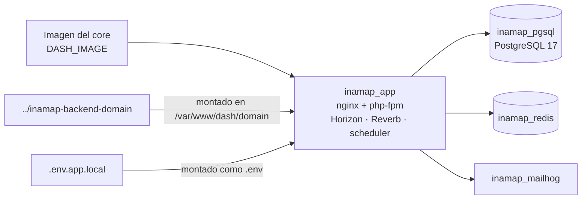

# 01 · Entorno local con Docker (`inamap-backend-docker`)

El backend de INAMAP corre en Docker: el **core DASHADMIN** viene en una imagen ya construida y
el **dominio INAMAP** (`inamap-backend-domain`) se monta encima desde tu disco, así que los
cambios del dominio se ven al instante sin reconstruir nada.



## 1. Requisitos

| Herramienta | Versión | Notas |
|---|---|---|
| Docker Desktop / Docker Engine | Compose v2 | En Windows, usar WSL2 y clonar dentro de WSL. |
| `bash` y `openssl` | — | Incluidos en macOS, Linux y WSL. |
| Imagen del core (`DASH_IMAGE`) | Tag fijo | La entrega el equipo del core. Para quien tiene el core: ver §8. |

## 2. Estructura de carpetas

Los repositorios deben quedar como **carpetas hermanas**:

```text
mi-carpeta/
├── inamap-backend-docker/     ← runtime (este documento)
├── inamap-backend-domain/     ← código del backend del dominio
├── inamap-frontend-domain/    ← frontend (ver 03-frontend.md)
└── inamap-documentation/      ← esta documentación
```

## 3. Primer arranque

```bash
cd inamap-backend-docker
./inamap.sh init
```

`init` crea, solo si no existen:

| Archivo | Contenido generado |
|---|---|
| `.env` | Variables de Compose: imagen, puertos, credenciales de la base. `DB_PASSWORD` aleatoria. |
| `.env.app.local` | Env de Laravel: `APP_KEY`, contraseñas de los usuarios de prueba, claves de Reverb, misma `DB_PASSWORD`. |

Luego, editar `.env` y poner la imagen del core:

```dotenv
DASH_IMAGE=farandal/dash-backend:<tag>-core
```

Y levantar:

```bash
./inamap.sh up
```

`up` levanta los contenedores, espera al contenedor `app`, aplica las migraciones (core + dominio)
y, **solo la primera vez**, siembra datos base, roles, permisos y usuarios de prueba (marca
`storage/.seeded`).

Los **datos de referencia** que necesita el registro de clientes (monedas CLP/USD, idiomas es/en
y el plan de prueba por defecto) los siembra el dominio. Si la base se sembró antes de que
existieran esos seeders, cargarlos con `./inamap.sh seed:base` (idempotente; no borra nada).

## 4. Servicios y puertos

| Servicio | Dirección | Uso |
|---|---|---|
| API | http://localhost:25200/api | Backend (Laravel). |
| Websockets (Reverb) | ws://localhost:27001 | Notificaciones en tiempo real. |
| Mailhog | http://localhost:25030 | Bandeja donde llegan todos los correos de desarrollo. |
| PostgreSQL | `localhost:25434`, base `im_dev_db`, usuario `im` | Contraseña en `.env` (`DB_PASSWORD`). Base de pruebas: `im_dev_db_test`. |
| Redis | `localhost:25389` | Colas, caché, grafo de rutas. |

Usuarios de prueba (creados al sembrar): correos y contraseñas en `.env.app.local`
(`SYSTEM_ADMIN_*`, `TENANT_ADMIN_*`, `NORMAL_USER_*`).

Conectarse a la base desde el host:

```bash
psql -h localhost -p 25434 -U im -d im_dev_db
```

## 5. Comandos de `inamap.sh`

| Comando | Qué hace |
|---|---|
| `./inamap.sh init` | Crea `.env` y `.env.app.local` con secretos nuevos (no sobrescribe). |
| `./inamap.sh up` | Levanta, migra y siembra la primera vez. Idempotente. |
| `./inamap.sh down` | Detiene los contenedores. **Los datos se conservan.** |
| `./inamap.sh restart` | Reinicia el contenedor `app` (regenera la caché de rutas y config). |
| `./inamap.sh status` | Estado de contenedores y de Horizon / Reverb / scheduler. |
| `./inamap.sh logs [laravel\|horizon\|reverb\|nginx\|<servicio>]` | Sigue un log (por defecto el de Laravel). |
| `./inamap.sh migrate` | `php artisan migrate` (nunca `migrate:fresh`). |
| `./inamap.sh seed` | `php artisan db:seed` (base nueva). |
| `./inamap.sh seed:base` | Monedas, idiomas y plan de prueba. Idempotente; seguro sobre una base con datos. |
| `./inamap.sh test [args]` | Suite `Domain` (unitarias + de integración) contra `im_dev_db_test`. |
| `./inamap.sh artisan <comando>` | Cualquier comando artisan. |
| `./inamap.sh shell` / `tinker` | Shell o Tinker dentro del contenedor. |
| `./inamap.sh tunnel:init` | Una vez: crea `.env.app.tunnel` y `.env.tunnel` (credenciales de Cloudflare). |
| `./inamap.sh up --tunnel` | Como `up`, con la env pública, y abre el Cloudflare Tunnel: API en `https://api-dev.inamap.space`, websockets en `wss://ws-dev.inamap.space`. Se recuerda hasta `down`. |
| `./inamap.sh tunnel` | Solo el túnel (el stack ya corre). |

Los modos local y túnel usan los mismos contenedores y la misma base; solo cambia la env de Laravel
(`.env.app.local` / `.env.app.tunnel`). Detalle y problemas frecuentes: `inamap-backend-docker/QUICK_COMMANDS.md`.

## 6. Archivos del runtime

| Archivo | Qué es | ¿Va a git? |
|---|---|---|
| `docker-compose.yml` | Stack completo; ningún montaje del código del core. | Sí |
| `docker-compose.core-dev.yml` | Overlay opcional que monta el código del core (§8). | Sí |
| `inamap.sh` | Utilitario de comandos. | Sí |
| `.env.example`, `.env.app.example` | Plantillas sin secretos. | Sí |
| `.env`, `.env.app.local` | Valores reales con secretos. | **No** |
| `docker/pgsql/create-testing-db.sh` | Crea la base principal y la de pruebas. | Sí |
| `domain-config-layers/` | Capas de config que se suman a las del core. `10-inamap-local/cors.php` permite los orígenes de los servidores de desarrollo del frontend (5180–5182); agregar ahí los dominios de staging/producción. Tras editar: `./inamap.sh restart`. | Sí |
| `storage/` | Archivos subidos, logs, caché, datos de PostgreSQL. | No |

## 7. Reglas

- **Nunca** `migrate:fresh`, `migrate:refresh` ni `db:wipe` sobre la base de desarrollo. Las
  pruebas usan su propia base.
- Los archivos `.env*` reales no se comparten por chat ni se suben a git: cada desarrollador
  genera los suyos con `./inamap.sh init`.
- Tras cambiar **rutas o archivos de config** del dominio: `./inamap.sh restart`.
- Tras agregar una **migración**: `./inamap.sh migrate`.
- Empezar de cero **a propósito**: `./inamap.sh down`, borrar `storage/pgsql-data` y
  `storage/.seeded`, y `./inamap.sh up`.

## 8. Para el equipo del core

Con `../dash-backend` clonado:

```bash
# Imagen local del core
cd ../dash-backend
docker build -f docker/php8.3/Dockerfile.core -t local/dash-backend-core:latest --build-arg OBFUSCATE_APP=false .

# En inamap-backend-docker/.env
DASH_IMAGE=local/dash-backend-core:latest

# Montar el código del core sobre la imagen (queda activo hasta ./inamap.sh down)
./inamap.sh up --core-dev
```

## 9. Problemas frecuentes

| Síntoma | Causa / solución |
|---|---|
| `Defina DASH_IMAGE en .env` | Falta la imagen del core en `.env`. |
| `pgsql_setup` nunca queda *healthy* y `app` no arranca | `DB_PASSWORD` distinta entre `.env` y `.env.app.local`, o se cambió con la base ya creada. |
| 500 "No application encryption key" | `.env.app.local` sin `APP_KEY` o sin permiso de lectura (`chmod 640`). |
| Puerto ocupado | Cambiar el puerto en `.env` y, si es la API o Reverb, también `APP_URL` / `REVERB_PORT` en `.env.app.local` y las URLs del frontend. |
| Rutas nuevas del dominio responden 404 | `./inamap.sh restart`. |
| `POST /api/trial/register` responde 422 `primary_currency: Invalid currency selected.` | Faltan los datos de referencia (monedas, idiomas, plan de prueba): `./inamap.sh seed:base`. |
| Los correos no llegan | Revisar Mailhog (http://localhost:25030); en desarrollo nada sale a Internet. |
| Cambios en colas/notificaciones no se reflejan | `./inamap.sh restart` (reinicia Horizon). |
