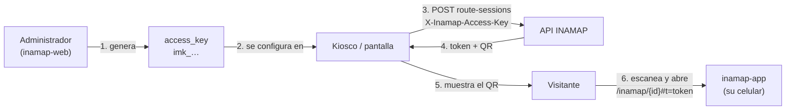

# 01 · Credencial de dispositivo (kioscos y pantallas)

## Resumen

La **credencial de dispositivo** (`access_key`) es un secreto por inamap que autoriza a un
equipo físico del recinto (un kiosco, una pantalla táctil, un tótem, una integración de
software) a **generar sesiones de ruta con código QR** sin que haya un usuario iniciando
sesión.

Su caso de uso principal: el inamap está en modo de acceso **`token_required`** (el visor
público no se puede abrir libremente) y el recinto quiere que, desde un kiosco, el visitante
elija su destino y se lleve la ruta al celular escaneando un QR. El kiosco necesita poder
crear esa sesión; la credencial es lo que lo autoriza.



## Conceptos clave

| Concepto | Qué es |
|---|---|
| **Credencial de dispositivo** (`access_key`) | Secreto de un inamap con forma `imk_` + 40 caracteres aleatorios. Autoriza a un equipo a consultar el mapa público (aunque esté en `token_required`) y a **crear** sesiones de ruta. No permite editar ni administrar. |
| **Sesión de ruta** | Ruta calculada y guardada en el servidor, expuesta con un **token** opaco y un QR. Ver [03 · Sesiones de ruta y QR](03-sesiones-de-ruta-y-qr.md). |
| **Token de sesión** | Lo que lleva el QR. Permite al visitante ver el inamap y su ruta en su propio dispositivo hasta que expira. |
| **Modo de acceso** | `open` o `token_required`. Ver [02 · Modos de acceso](02-modos-de-acceso.md). |

> La credencial **no es** el token del visitante. La credencial vive en el kiosco y es
> permanente hasta que se rota; el token vive en el celular del visitante y expira
> (por defecto a los 60 minutos).

## Cuándo se necesita

| Modo de acceso del inamap | ¿Quién puede crear una sesión de ruta? | ¿Hace falta la credencial? |
|---|---|---|
| `open` | Cualquiera (visitante, kiosco, integración) | No. Si se envía, debe ser válida. |
| `token_required` | Solo: un dispositivo con credencial válida, un usuario autenticado que administra el inamap, o un visitante que ya tiene una sesión válida | **Sí**, para kioscos y pantallas |

Si se envía la cabecera `X-Inamap-Access-Key` con un valor incorrecto, la solicitud se
rechaza con `403 ACCESS_KEY_INVALID` **en ambos modos**: una credencial mal configurada
se detecta de inmediato en lugar de quedar oculta mientras el inamap esté abierto.

## Cómo se genera (administración)

**Quién puede:** administrador del sistema, administrador de tenancy y administrador de
tenant (permiso `api.inamaps.accessKey.rotate`). El rol editor **no** puede.

### Desde el editor (`inamap-web`)

1. Abrir el inamap → menú lateral **MAPA › Configuración**.
2. En la sección **Credencial de dispositivo (kioscos)**, pulsar
   **Generar nueva credencial**.
3. Se muestra la credencial **una sola vez**. Copiarla con el botón de copiar y guardarla
   en un lugar seguro (gestor de contraseñas, configuración del kiosco).
4. Al cerrar el panel ya no se puede volver a ver; solo queda el aviso
   "Hay una credencial configurada".

### Desde la API

```http
POST /api/inamaps/{inamapId}/access-key/rotate
Authorization: Bearer <token del administrador>
X-Tenant-Id: <tenant>            (solo si un administrador de tenancy cambió de tenant)
```

Respuesta `200`:

```json
{
  "data": {
    "access_key": "imk_9fQ2…(40 caracteres)",
    "inamap_id": "8c1e…"
  }
}
```

## Cómo se usa (integración del kiosco)

El kiosco envía la credencial en la cabecera `X-Inamap-Access-Key` en **cada** llamada a la
API pública de su inamap. Para crear la sesión de ruta, el origen y el destino se indican
como `tipo:id` (`location`, `zone` o `structure`).

```http
POST /api/inamap/route-sessions
Content-Type: application/json
X-Inamap-Access-Key: imk_9fQ2…

{
  "inamap": "8c1e…",
  "from": "location:2b7d…",
  "to": "zone:a91c…",
  "accessible": false
}
```

Respuesta `201`:

```json
{
  "data": {
    "session_id": "5f0a…",
    "token": "Qm9…",
    "view_url": "https://app.inamap…/inamap/8c1e…#t=Qm9…",
    "qr_svg": "<?xml …",
    "expires_at": "2026-10-10T15:42:00Z",
    "route": { "distance": 184.2, "estimated_seconds": 166, "steps": [ … ] }
  }
}
```

El kiosco dibuja `qr_svg` en pantalla (o genera su propio QR con `view_url`). El visitante
lo escanea y su celular abre el visor con la ruta ya trazada.

### Ejemplo: `curl`

```bash
curl -X POST "$API/inamap/route-sessions" \
  -H "Content-Type: application/json" \
  -H "X-Inamap-Access-Key: $INAMAP_ACCESS_KEY" \
  -d '{"inamap":"'"$INAMAP_ID"'","from":"location:'"$ORIGEN"'","to":"location:'"$DESTINO"'"}'
```

### Ejemplo: JavaScript (aplicación del kiosco)

```js
async function crearSesionDeRuta({ apiUrl, inamapId, accessKey, from, to, accessible = false }) {
  const res = await fetch(`${apiUrl}/inamap/route-sessions`, {
    method: 'POST',
    headers: { 'Content-Type': 'application/json', 'X-Inamap-Access-Key': accessKey },
    body: JSON.stringify({ inamap: inamapId, from, to, accessible }),
  });
  const body = await res.json();
  if (!res.ok) throw new Error(body?.error?.code ?? `HTTP ${res.status}`);
  return body.data; // { token, view_url, qr_svg, expires_at, route }
}
```

### Lecturas del kiosco

Antes de crear la sesión, el kiosco necesita dibujar el mapa, buscar lugares y calcular la
ruta. En modo `token_required` esas lecturas exigen autorización: el kiosco envía la misma
cabecera `X-Inamap-Access-Key` y queda autorizado en:

| Endpoint | Uso en el kiosco |
|---|---|
| `GET api/inamap/{id}` | Dibujar el mapa |
| `GET api/inamap/search?inamap=…&q=…` | Buscar el destino |
| `GET api/inamap/route?inamap=…&from=…&to=…` | Mostrar la ruta en la pantalla del kiosco |
| `POST api/inamap/route-sessions` | Generar el QR para el visitante |

```bash
curl "$API/inamap/search?inamap=$INAMAP_ID&q=baños" -H "X-Inamap-Access-Key: $INAMAP_ACCESS_KEY"
```

## Rotación y revocación

- **Rotar** = generar una credencial nueva. La anterior deja de funcionar **en ese mismo
  instante**: solo se guarda una credencial por inamap.
- **Las sesiones ya creadas no se ven afectadas** por la rotación: los visitantes que ya
  escanearon un QR siguen viendo su ruta hasta que expire su token.
- No existe "revocar sin reemplazar": para invalidar una credencial filtrada se rota y se
  descarta la nueva si no se usará.

Procedimiento recomendado para rotar sin cortar el servicio:

1. Generar la credencial nueva en **Configuración**.
2. Actualizar la configuración de **todos** los kioscos del inamap.
3. Verificar en cada kiosco que la generación de QR funciona.

Entre el paso 1 y el 2 los kioscos con la credencial anterior reciben
`403 ACCESS_KEY_INVALID`; conviene hacerlo fuera del horario de atención.

## Seguridad

| Aspecto | Cómo se protege |
|---|---|
| Almacenamiento | El servidor guarda solo el **hash SHA-256** (`settings.access_key_hash`). La credencial en claro no se puede recuperar. |
| Exposición en la API | El hash nunca se devuelve. Los recursos exponen solo `settings.has_access_key: true/false`. |
| Comparación | En tiempo constante (`hash_equals`), sin filtrar información por tiempos de respuesta. |
| Alcance | Una credencial vale para **un solo inamap**: permite leer su mapa público, buscar, calcular rutas y crear sesiones de ruta. No permite editar, administrar ni leer nada de otros inamaps. |
| Abuso | Límite de 20 creaciones de sesión por minuto por IP e inamap (`INAMAP_SESSION_RATE_LIMIT`) y límite de sesiones activas por plan (`max_active_route_sessions`). |
| Trazabilidad | Cada sesión registra `created_by = device` cuando la creó un kiosco con credencial. |

### Dónde guardar la credencial en el kiosco

La credencial debe vivir **en el equipo**, no en código público:

- **Recomendado:** en la configuración del software del kiosco (archivo de configuración o
  variable de entorno), y que sea ese software el que llame a la API.
- **Aceptable en kioscos bloqueados:** dentro de una página web servida localmente al
  navegador del kiosco en modo kiosco, sin acceso a herramientas de desarrollo.
- **No hacer:** incluirla en una página o aplicación pública (por ejemplo, el visor que
  abren los visitantes en su celular). Cualquiera podría leerla y generar sesiones.

## Errores

| HTTP | Código | Causa | Qué hacer |
|---|---|---|---|
| 403 | `ACCESS_KEY_INVALID` | Credencial incorrecta, rotada, o ausente en un inamap `token_required` | Verificar la credencial configurada en el kiosco; rotar si se perdió. |
| 404 | `INAMAP_NOT_PUBLISHED` | El inamap no está publicado o no existe | Publicarlo desde el editor. |
| 422 | `ENDPOINT_NOT_FOUND` | El origen o destino no existe en este inamap | Revisar los ids `tipo:id`. |
| 422 | `NO_PATH_NEAR_ENDPOINT` | Origen o destino sin camino cercano | Dibujar caminos hasta ese lugar (ver diagnóstico de conectividad). |
| 404 | `UNREACHABLE` / `UNREACHABLE_ACCESSIBLE` | No hay ruta (o no hay ruta accesible) | Revisar caminos, sentidos y enlaces verticales. |
| 403 | `PLAN_LIMIT_REACHED` | Se alcanzó `max_active_route_sessions` del plan | Esperar a que expiren sesiones o ampliar el plan. |
| 429 | `THROTTLED` | Más de 20 sesiones por minuto desde la misma IP para el mismo inamap | Reintentar más tarde; revisar que el kiosco no esté en un bucle. |

## Referencia técnica

| Elemento | Ubicación |
|---|---|
| Generación | `InamapController::rotateAccessKey()` — `POST api/inamaps/{id}/access-key/rotate` |
| Validación | `RouteSessionController::create()` y `validAccessKey()` |
| Puerta de acceso | `InamapAccessToken` (middleware de la API pública): valida token o credencial |
| Persistencia | `inamaps.settings.access_key_hash` (SHA-256) |
| Permiso | `api.inamaps.accessKey.rotate` (`database/data/permissions.json`) |
| Límite de frecuencia | `RateLimiter` `inamap-sessions` en `AppDomainServiceProvider` |
| UI | `ina-maps` › `SettingsDrawer` (MAPA › Configuración) |

## Limitaciones conocidas y decisiones pendientes

- **Una credencial por inamap**, compartida por todos sus kioscos. Si se necesita revocar
  un solo equipo sin afectar a los demás, hará falta una credencial por dispositivo
  (evolución posible: tabla de dispositivos con nombre, última conexión y revocación
  individual).
- La regla "en `token_required` solo crean sesiones los dispositivos con credencial, los
  administradores o quien ya tiene una sesión" está registrada como **decisión S4b por
  confirmar** en la especificación.
