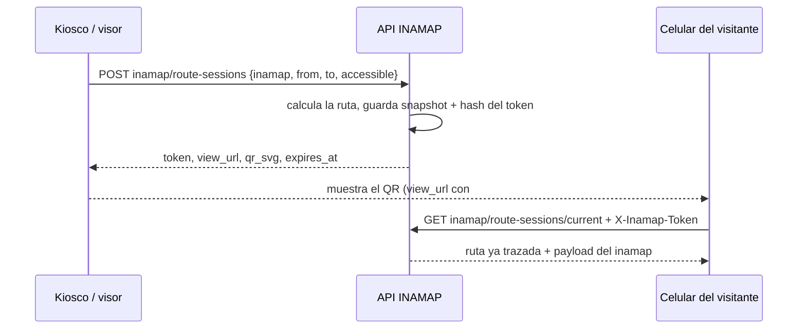

# 03 · Sesiones de ruta y código QR

Una **sesión de ruta** es una ruta calculada en el servidor, guardada como fotografía
(*snapshot*) y expuesta mediante un token y un código QR, para que el visitante la vea en su
propio celular sin repetir la búsqueda.

## Flujo

## Quién crea sesiones

- **Desde el visor público:** botón **Ver en mi celular** tras calcular una ruta.
- **Desde un kiosco:** con la [credencial de dispositivo](01-credencial-de-dispositivo.md).
- **Desde la administración:** un usuario autenticado que administra el inamap.

En `token_required`, ver las reglas en [02 · Modos de acceso](02-modos-de-acceso.md).

## Vida útil

- Duración configurable por inamap: **MAPA › Configuración › Duración de sesiones de ruta**
  (por defecto 60 minutos, máximo 1440).
- El mismo token puede abrirse en varios dispositivos hasta que expire (decisión **S4c**,
  por confirmar).
- Las sesiones vencidas hace más de un día se eliminan con el comando programado
  `inamap:prune-route-sessions` (diario).

## Qué contiene una sesión

| Campo | Descripción |
|---|---|
| `route` | Snapshot de la ruta: distancia, tiempo estimado y tramos por piso. Si el mapa se edita después, la sesión conserva la ruta original. |
| `token_hash` | SHA-256 del token. El token en claro solo se entrega al crear la sesión. |
| `expires_at` | Fin de la validez. |
| `created_by` | `visitor`, `device` o `editor`. |
| `first_opened_at`, `open_count` | Cuándo y cuántas veces se abrió. |

## Seguridad

- El QR no contiene datos personales: solo la URL del visor con un token opaco de 256 bits.
- El token viaja en el fragmento de la URL, fuera de los registros de acceso.
- Creación limitada a 20 por minuto por IP e inamap, y a `max_active_route_sessions` por plan.

## API

| Método y ruta | Descripción |
|---|---|
| `POST api/inamap/route-sessions` | Crea la sesión. Cuerpo: `inamap`, `from`, `to`, `accessible?`. |
| `GET api/inamap/route-sessions/current` | Devuelve la sesión del token enviado en `X-Inamap-Token` y registra la apertura. |
| `GET api/inamap/route-sessions/{id}/qr?format=svg\|png` | QR de la sesión; requiere el token de esa misma sesión. |
