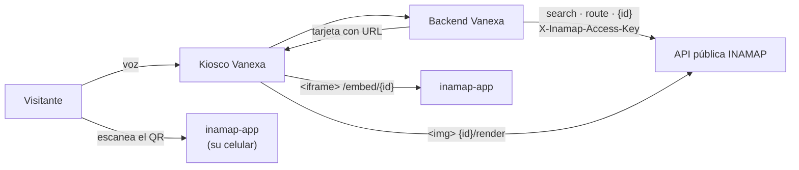

# Integración con Vanexa (kioscos con agente de voz)

## Resumen

**Vanexa** es una plataforma de kioscos con un agente de voz. Su integración con
INAMAP permite que, cuando un visitante pregunta *"¿dónde está el escenario
principal?"*, *"¿dónde puedo comer?"* o *"¿cómo llego a los baños?"*, la pantalla
del kiosco muestre **el mapa del recinto** con lo que preguntó: un lugar, varios
lugares numerados o la ruta a pie desde el kiosco.

INAMAP no sabe nada de Vanexa: la integración usa la **API pública** de siempre
(`api/inamap/*`) más dos piezas pensadas para pantallas que no corren el visor
interactivo: la **imagen del mapa** (`{id}/render`) y las **URL del visor** que
abren un lugar, un conjunto de lugares o una ruta ya trazados.

> La parte de Vanexa (herramientas del agente, configuración de la instancia,
> flujos de conversación) está en `vanexa-backend-domain/docs/INAMAP.md`. Este
> documento cubre **lo que INAMAP ofrece y exige** a esa integración.



## Qué consume Vanexa

| Llamada | Quién | Con credencial | Para qué |
|---|---|---|---|
| `GET api/inamap/{id}` | backend de Vanexa | sí | nombres, pisos, lugares, categorías y `terms` (se cachea 60 s) |
| `GET api/inamap/search?inamap=&q=&limit=` | backend de Vanexa | sí | encontrar lugares por lo que dice el visitante |
| `GET api/inamap/route?inamap=&from=&to=&accessible=` | backend de Vanexa | sí | distancia y tiempo a pie desde el kiosco |
| `GET api/inamap/{id}/render?…` | **navegador del kiosco** (``) | **no** | imagen PNG del mapa |
| `GET /inamap/{id}?…` y `/embed/{id}?…` | navegador del kiosco y celular | **no** | visor interactivo |

La credencial (`X-Inamap-Access-Key`, ver
[01 · Credencial de dispositivo](01-credencial-de-dispositivo.md)) **solo viaja de
servidor a servidor**. Las URL que Vanexa entrega al kiosco no la contienen.

## Requisitos del inamap

| Requisito | Por qué |
|---|---|
| **Publicado** | si no, toda llamada pública responde `404 INAMAP_NOT_PUBLISHED` |
| **Modo de acceso `open`** | la imagen y el visor los carga el *navegador* del kiosco, sin credencial; en `token_required` responden `401 TOKEN_REQUIRED`. Las lecturas servidor a servidor funcionan en ambos modos con la credencial (ver [02 · Modos de acceso](02-modos-de-acceso.md)) |
| **Caminos conectados** | sin camino entre el punto de partida y el destino la ruta falla (`NO_PATH_NEAR_ENDPOINT`, `UNREACHABLE`) y Vanexa muestra solo el lugar |
| **`terms` en los lugares** | la búsqueda no tiene sinónimos: lo que no está en etiqueta, código, categoría o `terms` no se encuentra |
| **Alcanzable** | desde el servidor de Vanexa y desde el navegador del kiosco |

### Cómo preparar el mapa para el agente

| Para que el agente… | Hay que… |
|---|---|
| encuentre "comida" | poner `terms` (`comer`, `almorzar`, `restaurante`, `food`) en esos lugares, o usar una categoría llamada así |
| entienda "primeros auxilios" | agregar ese término a la enfermería |
| ubique al kiosco por nombre | que el lugar donde está tenga etiqueta propia (p. ej. "Entrada 1") y, si se dice de otra forma, `terms` (`uno`, `entrada`) |
| distinga cuatro baños | nada: se devuelven ordenados por cercanía al kiosco; mantenga **códigos** únicos (`B001`, `B005`…) para citarlos |

> Una **estructura** (escenario, entrada) o una **zona** también es un lugar
> válido de origen y destino, igual que una **ubicación**.

## Búsqueda y `terms`

`GET api/inamap/search` busca en zonas, estructuras y ubicaciones del inamap:

- El texto buscable de cada elemento es: etiqueta, código y `terms`; para una
  ubicación, además el nombre de su categoría.
- Puntaje: el mayor entre la similitud de palabra (`word_similarity`, umbral
  `inamap.search.similarity_threshold`, 0.2) y 1.0 cuando el texto contiene la
  consulta. Orden: puntaje descendente y luego etiqueta.
- Con `category` (uuid) solo se buscan **ubicaciones** de esa categoría y de sus
  subcategorías; con `q` vacío, devuelve todas ellas.
- `limit`: por defecto 20, máximo 50. Vanexa pide 5.

Respuesta (cada elemento): `type`, `id`, `label`, `code`, `layout_id`,
`category_id`, `score`.

### `terms` en el payload público

`GET api/inamap/{id}` expone `terms` en **zonas, estructuras y ubicaciones**
(antes solo en ubicaciones). Vanexa lo usa para reconocer el nombre del kiosco
sin consultar la búsqueda: si todas las palabras del nombre aparecen entre la
etiqueta, el código y los `terms` de un único lugar, ese es el punto de partida.

## La imagen del mapa: `GET api/inamap/{id}/render`

Devuelve un **PNG** de un piso. Sin interacción: pensado para una tarjeta de
kiosco, un correo o un mensaje. Solo acepta **referencias** (`tipo:uuid`); toda
coordenada sale del propio inamap.

### Parámetros

| Parámetro | Valor | Descripción |
|---|---|---|
| `focus` | `tipo:uuid` | un lugar, resaltado con su pin (o contorno si es un área) |
| `from`, `to` | `tipo:uuid` | ruta a pie de `from` a `to`; `to` también enfoca el piso |
| `places` | `tipo:uuid,tipo:uuid…` | hasta **12** lugares, cada uno con un **disco numerado** (1…n, en el orden dado) y **sin ruta**; ignora `focus`, `from` y `to` |
| `accessible` | `0`/`1` | ruta sin escaleras |
| `layout` | uuid | piso; por omisión el del lugar enfocado, el del primer lugar de `places` o el inicial |
| `w` | 240–1600 | ancho en px (900 por omisión); la altura sale del plano |
| `lang` | `es`/`en` | idioma del texto bajo el mapa (`es`) |
| `qr` | `0`/`1` | incluir el QR (`1`) |

Combinaciones:

| Petición | Resultado |
|---|---|
| `focus=…` | el lugar resaltado, sin ruta |
| `from=…&to=…` | ruta punteada del origen al destino, con el origen (verde) y el destino (rojo) |
| `places=a,b,c` | tres discos numerados 1, 2, 3 |
| sin parámetros de lugar | el plano completo |

### Cómo se dibuja

| Elemento | Detalle |
|---|---|
| Fondo | la imagen del plano del piso (o, sin imagen, las zonas y estructuras) |
| **Ruta** | **una sola línea punteada**: el patrón de trazos sigue de corrido por las esquinas y por los muchos tramos cortos de la ruta (se unen en un solo trazado); **sin marcadores en los vértices**. Trazo rojo con borde blanco; grosor `max(3, w/150)` px |
| Lugares (`places`) | disco rojo con borde blanco y número; si el lugar es un área, además su contorno |
| **QR** | franja **debajo** del mapa (no encima: un plano puede ser una tira delgada), con el código a la derecha y un texto a la izquierda |

La franja del QR mide `clamp(w·0.25, 140, 300)` px de lado más margen. El QR
codifica la URL del visor `…/inamap/{id}` con los mismos parámetros de la imagen:

| La imagen muestra | El QR abre |
|---|---|
| un lugar (`focus`) | `?to=tipo:uuid` |
| una ruta | `?to=…&from=…[&accessible=1]` |
| un conjunto | `?places=l:uuid,s:uuid,…` (el tipo en una letra: `l` ubicación, `s` estructura, `z` zona, para que el enlace —y el QR— sea corto) |
| el plano completo | el mapa |

Con `lang=en`, el QR añade `lang=en`. Se usa **corrección de errores baja**
para que un enlace largo siga siendo legible a tamaño de pantalla. **No se
dibuja** en un inamap `token_required` (un enlace sin token no abriría en el
celular) ni con `qr=0`.

### Respuestas

| HTTP | Cuándo |
|---|---|
| `200 image/png` | `Cache-Control: public, max-age=300` (`private` si el inamap exige token) |
| `404 INAMAP_NOT_PUBLISHED` | no publicado |
| `401 TOKEN_REQUIRED` | `token_required` sin credencial ni token |
| `422 ENDPOINT_NOT_FOUND` | alguna referencia no pertenece a este inamap |
| `404 UNREACHABLE` / `UNREACHABLE_ACCESSIBLE`, `422 NO_PATH_NEAR_ENDPOINT` | la ruta pedida no existe |
| `422` (validación) | `w` fuera de rango, `lang` inválido, `places` demasiado largo (900) |

### Caché

El servidor guarda el PNG **10 minutos**, con clave = opciones + `updated_at` del
inamap + el `updated_at` más reciente de sus layouts: editar el mapa invalida la
imagen. El payload JSON de `{id}` se sirve con `ETag` y 60 s en inamaps `open`.

## El visor: parámetros de URL

`inamap-app` sirve el mismo visor en dos rutas:

| Ruta | Uso |
|---|---|
| `/inamap/{id}` | pantalla completa (celular, navegador) |
| `/embed/{id}` | dentro de un `iframe` (la tarjeta interactiva del kiosco): la barra de búsqueda y ruta **parte cerrada** y se deja libre la esquina superior derecha, donde el anfitrión dibuja su botón de cerrar |

| Parámetro | Valor | Efecto |
|---|---|---|
| `to` | `tipo:uuid` | muestra ese lugar (y lo deja como destino) |
| `from` | `tipo:uuid` | con `to`, **calcula la ruta al abrir** y encuadra el recorrido |
| `accessible` | `1` | la ruta es sin escaleras |
| `places` | `tipo:uuid,…` o `l:uuid,s:uuid,z:uuid` | marca esos lugares con discos numerados, abre en el piso del primero y los encuadra; **no traza ninguna ruta** |
| `location` | uuid | forma antigua: enfoca una ubicación (la aceptan visores previos) |
| `lang` | `es`/`en` | idioma de la interfaz |
| `#t=` | token | sesión de ruta (ver [03 · Sesiones de ruta y QR](03-sesiones-de-ruta-y-qr.md)); va en el fragmento |

Reglas:

- Las referencias se **resuelven contra el propio inamap**; una desconocida se
  ignora. Nunca se confía en el texto de la URL.
- El **idioma por omisión es español**, sin importar el idioma del dispositivo
  (los kioscos suelen venir en inglés de fábrica). Solo `?lang=en` lo cambia.
- Con `places`, el orden de los parámetros es el de la numeración: el disco 1 es
  el primero de la lista.

### Interfaz

| Elemento | Comportamiento |
|---|---|
| **Barra superior delgada**, en columnas | nombre y botón de búsqueda · origen · destino · invertir, ruta accesible y "Cómo llegar" · categoría · distancia y tiempo con las indicaciones en un desplegable · tema claro/oscuro |
| Mapa | ocupa todo lo que queda **bajo** la barra: nada lo tapa |
| **QR** | superpuesto abajo a la derecha del mapa, de 120 a 176 px según el alto de la ventana, con un texto corto; abre el mismo lugar, conjunto o ruta en el celular. Los controles de zoom quedan encima |
| Ficha de ubicación | abajo a la izquierda |
| En un celular | el QR no se muestra (ya se está en el celular), salvo dentro de una tarjeta |
| Inamap `token_required` | en lugar del QR, un botón crea una **sesión de ruta** y muestra su código |

## Seguridad

| Aspecto | Cómo se cuida |
|---|---|
| La credencial | solo en llamadas de servidor a servidor; ninguna URL entregada al kiosco la lleva; Vanexa la guarda cifrada y la oculta de sus registros |
| Datos expuestos sin credencial | los de un inamap `open`, que ya son públicos por definición |
| Referencias | siempre `tipo:uuid` verificado contra el inamap; no se aceptan coordenadas del cliente |
| Abuso | `inamap-public`: **120 peticiones/min por IP** (`INAMAP_PUBLIC_RATE_LIMIT`) |
| Caché | `private` en `token_required` |

> **Atención al límite por IP.** Todas las llamadas del backend de Vanexa salen de
> la misma IP, de modo que **todos sus kioscos comparten ese presupuesto**. Una
> conversación cuesta unas pocas llamadas (una búsqueda, a lo sumo una ruta; el
> payload se cachea 60 s y la ruta 90 s). Si muchos kioscos comparten un servidor
> de Vanexa, suba `INAMAP_PUBLIC_RATE_LIMIT`.

## Qué campos del payload lee Vanexa

Un cambio en estos campos rompe la integración; el resto del payload puede
evolucionar libremente.

| Campo | Uso |
|---|---|
| `name`, `unit` | título de la tarjeta; metros para estimar distancias en línea recta |
| `layouts[].id`, `name` | nombre del piso |
| `zones[]`, `structures[]`: `id`, `layout_id`, `code`, `label`, `terms`, `polygon` | lugares; el punto se calcula como el centro del polígono |
| `locations[]`: `id`, `layout_id`, `code`, `label`, `terms`, `x`, `y`, `category_id` | lugares |
| `categories[]`: `id`, `name` | tipo del lugar y reintento por categoría |
| `settings.access_mode` | informativo |

De `search`: `type`, `id`, `label`, `code`, `layout_id`, `category_id`, `score`.
De `route`: `distance` (metros) y `estimated_seconds`.

## Probar la integración

```bash
API=https://api-dev.inamap.space/api/inamap
ID=a2f8240e-569d-496e-9c3c-3abc3a6335ff

# 1. el mapa y sus términos
curl -s "$API/$ID" | jq '.data.structures[] | {label, code, terms}'

# 2. buscar como lo hace el agente
curl -s "$API/search?inamap=$ID&q=baños&limit=5" | jq '.data[] | {label, code, score}'

# 3. la imagen: un conjunto de lugares
curl -s -o places.png "$API/$ID/render?places=location:<uuid1>,location:<uuid2>&w=900"

# 4. la imagen: una ruta
curl -s -o route.png "$API/$ID/render?from=structure:<origen>&to=structure:<destino>&w=900"

# 5. el visor, como lo abre el QR
open "https://app-dev.inamap.space/inamap/$ID?to=structure:<destino>&from=structure:<origen>"
```

Pruebas automáticas:

| Qué | Dónde |
|---|---|
| Trazo punteado, esquinas, rutas con muchos puntos, unión de tramos, enlaces del QR | `inamap-backend-domain/tests/Unit/Inamap/MapRenderServiceTest.php` (sin base de datos) |
| Diccionarios es/en con las mismas claves | `inamap-frontend-domain/packages/ina-viewer/src/__tests__/viewerStrings.test.ts` |
| Geometría del visor | `…/ina-viewer/src/__tests__/geometry.test.ts` |

```bash
docker exec inamap_app php artisan test domain/tests/Unit --no-ansi
cd inamap-frontend-domain/packages/ina-viewer && pnpm test
```

## Problemas frecuentes

| Síntoma | Causa | Qué hacer |
|---|---|---|
| El kiosco muestra un marco vacío | la imagen o el visor responden `401`: el inamap está en `token_required` | usar `open`, o no usar la imagen en ese kiosco |
| El agente no encuentra "baños" / "comida" | faltan `terms` | agregarlos en el editor y esperar ≤ 60 s (caché del payload) |
| La ruta no aparece | no hay camino entre el origen y el destino, o el origen no se resolvió | revisar caminos (diagnóstico de conectividad) y el nombre del origen en la instancia de Vanexa |
| El texto bajo el mapa o el visor salen en el idioma equivocado | falta `lang` en la URL (el visor y el pie del mapa usan español por omisión) | Vanexa lo envía según el campo **Idioma del mapa** de la instancia; revisarlo |
| `429` | demasiadas llamadas desde la misma IP | subir `INAMAP_PUBLIC_RATE_LIMIT` |
| El QR no se escanea | enlace muy largo (muchos lugares) o pantalla con brillo bajo | reducir lugares, aumentar `w` |

## Referencia técnica

| Elemento | Ubicación |
|---|---|
| Imagen del mapa | `inamap-backend-domain/app/Services/Inamap/Render/MapRenderService.php` |
| Endpoint `render` y payload público | `…/app/Http/Controllers/API/Public/PublicInamapController.php` |
| Rutas públicas | `…/routes/api/inamap_public.php` |
| Puerta de acceso | `…/app/Http/Middleware/InamapAccessToken.php` |
| Búsqueda | `…/app/Services/Inamap/Search/LocationSearchService.php` |
| Resolución de referencias | `…/app/Services/Inamap/Routing/EndpointResolver.php` |
| QR | `…/app/Services/Inamap/Qr/QrService.php` (`render(..., compact: true)`) |
| URL base del visor | `config/inamap.php` → `route_sessions.app_url` (`INAMAP_APP_URL`) |
| Visor | `inamap-frontend-domain/packages/ina-viewer/src/components/InamapViewer.tsx`, `MapCanvas.tsx`, `SearchBox.tsx` |
| Rutas del visor y lectura de la URL | `inamap-frontend-domain/apps/inamap-app/src/main.tsx` |
| Textos | `…/ina-viewer/src/i18n/viewerStrings.ts` |

## Limitaciones y decisiones pendientes

- **Un piso por imagen.** Los lugares de otro piso que el del primero no se
  marcan en el PNG; el visor interactivo sí cambia de piso.
- **Credencial por inamap.** Una sola para todos los kioscos de ese mapa.
  La evolución prevista es emitir **tokens por cuenta de servicio** (con
  expiración, activación/desactivación y validez ligada a la tenancy) y aceptarlos
  en estos mismos endpoints para los mapas del propio tenant; hoy no está
  implementado.
- **Distancias en línea recta** (para ordenar lugares parecidos) son
  aproximadas: solo el mejor resultado recibe una ruta real.
- **Sin sinónimos propios**: la búsqueda se apoya únicamente en `terms`, etiqueta,
  código y categoría; no hay diccionario de idiomas ni de números hablados.
- **La imagen no sirve inamaps `token_required`** a un kiosco sin un proxy en
  Vanexa (no implementado).
