# INAMAP

INAMAP es una plataforma de mapas interactivos diseñada para la orientación y localización de personas dentro de recintos, campus, edificios o eventos. El sistema permite administrar mapas, definir espacios geográficos y calcular rutas óptimas entre distintos puntos de interés.

## Arquitectura de Datos

La estructura principal se compone de:

- **Mapas**: contenedores principales asociados a un sistema de coordenadas.
- **Layouts**: representan niveles o planos (por ejemplo, pisos de un edificio) y poseen una imagen de fondo.
- **Zonas**: polígonos que representan áreas lógicas o abstractas. No pueden superponerse.
- **Estructuras**: polígonos sólidos que representan edificios, pabellones u otras construcciones.
- **Ubicaciones**: puntos georreferenciados que contienen información, etiquetas, categorías, iconos y códigos QR.
- **Caminos**: red de rutas conectadas mediante segmentos dirigidos que permiten calcular recorridos entre ubicaciones.

## Funcionalidades principales

### Administración de mapas

- Creación y gestión de mapas y layouts.
- Carga de imágenes de fondo para cada layout.
- Edición visual mediante canvas.
- Creación y edición de:
  - Zonas (polígonos delíneados)
  - Estructuras (polígonos sólidos)
  - Ubicaciones (puntos de interés)
  - Caminos (vectores dirigidos)

### Sistema de navegación

- Definición de caminos con sentido de circulación.
- Conexión entre caminos dentro y entre layouts.
- Soporte para elementos de transición entre niveles (ascensores, escaleras, etc.).
- Cálculo automático de rutas óptimas entre origen y destino.
- El origen y destino pueden corresponder a:
  - Ubicaciones
  - Estructuras
  - Zonas

### Búsqueda inteligente

El sistema implementa búsqueda difusa (Fuzzy Search) sobre:

- Nombres
- Etiquetas
- Categorías
- Metadata personalizada

Las búsquedas pueden devolver resultados de tipo:

- Zona
- Estructura
- Ubicación
- API

### API

#### Búsqueda de ubicaciones

```http
GET /api/inamap/search?inamap={id}&q={termino}
```

Retorna coincidencias utilizando Fuzzy Search.

#### Cálculo de ruta

```http
GET /api/inamap/route?inamap={id}&from={origen}&to={destino}&accessible={true|false}
```

Entrega la ruta óptima considerando la dirección y conectividad de los caminos.

#### Visualización pública

```http
GET /inamap/{id}
```

Renderiza un mapa interactivo con:

- Imagen de fondo del layout
- Zonas
- Estructuras
- Ubicaciones
- Ruta calculada entre dos puntos

## Representación visual

| Elemento | Representación |
|---|---|
| Zona | Polígono con color configurable |
| Estructura | Polígono sólido con color configurable |
| Ubicación | Punto con icono, etiqueta y metadata |
| Camino | Línea dirigida conectable a otras líneas |
| Layout | Imagen de fondo con sistema de coordenadas métrico |

## Objetivo

Proporcionar una plataforma de navegación indoor que permita modelar espacios físicos complejos y entregar rutas visuales entre puntos de interés mediante APIs y una interfaz web interactiva.


## Introducción — Alcance de este documento y cómo leerlo

Este documento cumple dos funciones:

1. **Especificación técnica** de cómo INAMAP se implementa como un *dominio* sobre el framework DASHADMIN: backend, frontend, runtime y despliegue. Sirve de introducción de arquitectura para desarrolladores que se incorporan.

2. **Especificación funcional**: requerimientos, historias de usuario, modelo de datos y flujos esperados.

| Parte | Contenido | Lector principal |
|---|---|---|
| 1 | Visión y alcance del producto | Todos |
| 2 | Análisis de la arquitectura de referencia (DASH) | Desarrolladores nuevos |
| 3 | Arquitectura del dominio INAMAP — backend | Backend |
| 4 | Arquitectura del dominio INAMAP — frontend | Frontend |
| 5 | Runtime, entornos y despliegue | DevOps / todos |
| 6 | Requerimientos funcionales (RF) e historias de usuario (HU) | Producto / QA / todos |
| 7 | Modelo de datos (diagramas ER) | Todos |
| 8 | Flujos de usuario y de sistema (Mermaid) | Todos |
| 9 | Catálogo de API | Backend / Frontend |
| 10 | Requerimientos no funcionales, riesgos, supuestos, plan de entrega | Todos |

**Convención de identificadores:** `RF-xx` requerimiento funcional · `RNF-xx` no funcional · `HU-<ACTOR>-xx` historia de usuario · `FL-xx` flujo · `ER-xx` diagrama entidad-relación.

---

# PARTE 1 — Visión y alcance

## 1.1 Qué es INAMAP

INAMAP es un sistema de **mapas para guía y localización en recintos** (ferias, campus, centros comerciales, hospitales, eventos). Permite que:

- Una **Tenancy Account** es requerido para utilizar la plataforma. Una Tenancy Account puede tener multiples clientes, y un cliente puede tener multiples mapas.
- Un **cliente (tenant)** tiene mapas, y es requerido. El cliente administra los mapas, cargua las imágenes de planta de su recinto y modele sobre ellas **zonas, estructuras, ubicaciones y caminos**.
- Un **visitante** puede ver el mapa publicado, **buscar** un lugar con términos libres y obtenga la **ruta óptima** del punto A al punto B, dibujada sobre el plano, incluso entre pisos.

## 1.2 Objetivos

| # | Objetivo |
|---|---|
| O1 | Administrar mapas con un sistema de coordenadas en **metros** inicialmente, aunque debería ser agnóstica a la unidad, con múltiples *layouts* (capas / pisos) por mapa. |
| O2 | Modelar zonas (sin solapamiento), estructuras, ubicaciones y caminos dirigidos, con conexiones entre caminos y entre layouts. |
| O3 | Calcular rutas A→B respetando el sentido de circulación, con origen/destino que puede ser ubicación, estructura o zona. |
| O4 | Exponer búsqueda difusa (*fuzzy*) por términos, categorías y metadata, y un endpoint público para visualizar el mapa en HTML. |
| O5 | Reutilizar íntegramente la plataforma DASH (identidad, tenancy, planes, notificaciones) sin mover lógica de negocio al core. |

## 1.3 Dentro / fuera de alcance (v1)

### Dentro de alcance

- Backend `inamap-backend-domain`
- Runtime local aislado `inamap-backend-docker` (imagen del core + dominio montado), con instrucciones para que los desarrolladores lo levanten en su equipo.
- Frontend: `inamap-system`, `inamap-web`, `inamap-app` + paquetes `ina-*`
- Búsqueda difusa, cálculo de rutas, API pública
- Planes y límites por suscripción por omisión (reuso del core) - Un cliente y un mapa para el plan de prueba. 
- Documentación completa en español

### Fuera de alcance (v1)

- Infraestructura de producción (`inamap-ci-cdk`) — documento aparte
- Aplicaciones móviles nativas / Electron / kioscos

### Fuera de alcance (Futuro)

- Posicionamiento en tiempo real del visitante (GPS/BLE/Wi‑Fi)
- Navegación por voz / realidad aumentada
- Importación de CAD/DXF/GeoJSON (se anota como evolución)
- PostGIS y consultas geoespaciales en base de datos

## 1.4 Actores

| Actor | Rol en DASH | App | Descripción |
|---|---|---|---|
| **Visitante** | *(anónimo, sin rol)* | `inamap-app` | Consulta un mapa público, busca y pide rutas. |
| **Editor de mapas** | Usuario normal del tenant (permisos acotados vía `normalUserPermissions.json`) | `inamap-web` | Dibuja y mantiene geometría y datos; no administra cuenta. |
| **Administrador de tenant** | `TenantAdmin` (core) | `inamap-web` | Gestiona sus mapas, categorías, usuarios del tenant y publicación. |
| **Administrador de tenancy** | `TenancyAdmin` (core) | `inamap-web` / `inamap-system` según nivel | Administra varios tenants (p. ej. una agencia con varios clientes); usa *TenantSwitcher*. |
| **Administrador de sistema** | `SystemAdmin` (core) | `inamap-system` | Opera la plataforma: tenancies, planes, pasarelas, auditoría. |

> **Regla del framework:** los roles de plataforma **no se redefinen** en el dominio; INAMAP solo agrega *permisos* nuevos y los asigna a roles existentes (ver §3.6).

---

# PARTE 2 — Análisis de la arquitectura de referencia

## 2.1 Principio rector

> El **core** (`dash-backend`) es dueño de la plataforma. El **dominio** es dueño del negocio. Ninguno se filtra en el otro.

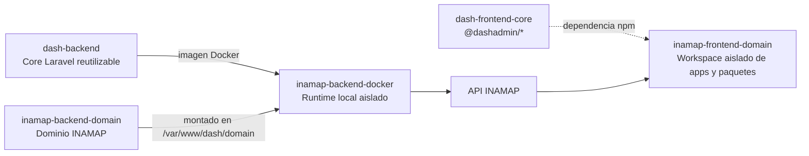

## 2.2 Repositorios involucrados

| Repo | Rol para INAMAP | ¿Se modifica? |
|---|---|---|
| `dash-backend` | Core: identidad, tenancy, planes, billing, mensajería | **No** (solo se consume) |
| `inamap-backend-domain` | **NUEVO.** Lógica de mapas, geometría, rutas, búsqueda | Sí (creado) |
| `inamap-backend-docker` | **NUEVO.** Runtime local aislado: compose, plantillas de env, utilitario `inamap.sh` | Sí (creado) |
| `dash-backend-docker` | Runtime compartido del framework (otros proyectos) | **No** |
| `inamap-frontend-domain` | **NUEVO.** Workspace aislado: apps `inamap-*` y paquetes `ina-*` (sin paquetes de otros dominios) | Sí (creado) |
| `dash-frontend-core` | Framework `dash-admin` publicado como `@dashadmin/*` | **No** |

## 2.3 Hallazgos verificados en el código (afectan el diseño)

| # | Hallazgo | Consecuencia para INAMAP |
|---|---|---|
| H1 | `config/app.php` registra `Domain\App\Providers\AppDomainServiceProvider` solo si la clase existe; el provider **extiende** `AppServiceProvider`. | El único artefacto obligatorio del dominio es ese provider. |
| H2 | `routes/api.php` del dominio es un cargador `glob('domain/routes/api/*.php')`. | Agregar archivos de rutas no requiere registro adicional. |
| H3 | El core carga automáticamente `domain/config/*.php`, `domain/resources/lang`, `domain/database/migrations` (y subcarpetas), y `domain-config-layers/*/`. | Config, traducciones y migraciones se "enchufan" por convención de carpeta. |
| H4 | `DatabaseSeeder` descubre `domain/database/seeders/<Carpeta>/<Clase>` como `Domain\Database\Seeders\<Carpeta>\<Clase>`. | Seeders de permisos/roles/datos demo sin tocar el core. |
| H5 | El `composer.json` del core define PSR-4 `Domain\App\…` y fusiona `domain/composer.json`. | El dominio usa los namespaces estándar del framework (`Domain\App\…`); solo cambia el repositorio montado. |
| H6 | El runtime compartido monta archivos sueltos del código del core (`../dash-backend`), y su overlay *image-only* no los elimina en Compose v2+ (las listas de volúmenes se fusionan). | El runtime de INAMAP es un compose propio, sin ningún montaje del core: funciona solo con la imagen (§5.1). |
| H7 | El core referencia clases de dominio **siempre tras `class_exists`** (guardas de opcionalidad). | Un dominio nuevo no necesita implementar ninguna de ellas; solo el provider es obligatorio. |
| H8 | El framework incluye una plantilla CRUD de referencia `Example/Todo` (Controller, Request, Resource, Filter, Policy, TrashController) + `routes/api/example.php`. | Es el patrón que replica **cada** recurso de INAMAP (extiende `ReactAdminBaseController`). |
| H9 | PostgreSQL corre como `postgres:latest` **sin PostGIS**. | Geometría en JSON + algoritmos en PHP; búsqueda difusa con `pg_trgm` + `unaccent` (extensiones propias del dominio, `CREATE EXTENSION IF NOT EXISTS`). |
| H10 | Cada proyecto del runtime ocupa un bloque propio de puertos (API, Reverb, PostgreSQL, Redis, Mailhog, API Docs). | INAMAP requiere un bloque nuevo sin colisión (§5.2). |
| H11 | La imagen del core incluye `tests/` y `phpunit.xml`, y su `TestCase` migra y siembra la base de pruebas. | La suite `Domain` corre en el runtime aislado sin montar nada del core. |
| H12 | El core despacha `Domain\App\Jobs\Listeners\TenantProvisioningJob` solo si existe. | Punto de extensión para aprovisionar datos iniciales de un tenant nuevo (§3.7). |
| H13 | El frontend es pnpm + Turborepo: `apps/<x>-{app,web,system}` + `packages/<prefijo>-*`; los paquetes de dominio usan `tsup` con `bundle:false`, `exports` comodín y `typesVersions`. | Prefijo `ina-*` para los paquetes de INAMAP; receta en el skill `frontend-new-package`. |
| H14 | El módulo *TenantSettings* del core fusiona `domain/config/tenant_settings.php` en los ajustes de cada tenant. | La velocidad peatonal (y otros ajustes) se exponen como *tenant settings* sin tocar el core (§3.5). |

## 2.4 Qué se reutiliza del core (sin reimplementar)

| Capacidad | Mecanismo del core | Uso en INAMAP |
|---|---|---|
| Autenticación | Sanctum, login/refresh, `TrialRegistrationController` | Login y **registro de tenants** en `inamap-web` |
| Tenancy | `Tenancy`/`Tenant`, `TenancyContextService`, `TenantSwitcher` | Aislamiento por tenant, cambio de tenant del TenancyAdmin |
| Roles y permisos | Spatie + `PermissionSeeder`/`RoleSeeder` por JSON | Permisos `inamap.*` por rol |
| Planes y límites | `SubscriptionPlan`, `PlanLimitsService` | Límites de inamaps/layouts/ubicaciones por plan |
| Ajustes de tenant | Módulo *TenantSettings* | Velocidad peatonal, marca del visor |
| Mensajería | `AppNotificationBuilder`, Reverb, Horizon | Avisos (publicación, límites) — opcional v1 |
| Medios | Spatie MediaLibrary + `HandlesImageUploads` + `DashFileStorage` | Imagen de fondo de cada layout (skill `dashadmin-images`) |
| CRUD estándar | `ReactAdminBaseController` + `config('react-admin-methods')` | Todos los recursos administrables |

---

# PARTE 3 — Arquitectura backend: `inamap-backend-domain`

## 3.1 Integración core ↔ dominio

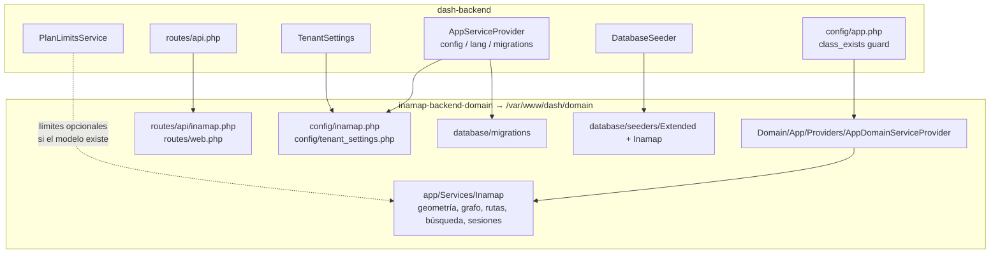

## 3.2 Estructura de carpetas del repositorio

```text
inamap-backend-domain/
├── composer.json                       # endroid/qr-code (ya incluido en la imagen del core)
├── README.md                           # este documento (especificación técnica)
├── app/
│   ├── Providers/{AppDomainServiceProvider,CommandServiceProvider}.php
│   ├── Models/Inamap/
│   │   ├── InamapModel.php             # base: UUID, filtros, borrado lógico, scope visibleTo()
│   │   ├── {Inamap,Layout,Zone,Structure,Category,Location,Path,PathLink,RouteSession}.php
│   │   └── Concerns/IsSearchable.php   # mantiene search_text normalizado
│   ├── Http/
│   │   ├── Controllers/API/Inamap/
│   │   │   ├── InamapBaseController.php, InamapPolicy.php, InamapFilter.php, InamapRequest.php
│   │   │   ├── PolygonController.php   # base de zonas/estructuras (regla de solapamiento)
│   │   │   ├── {Inamap,Layout,Zone,Structure,Category,Location,Path,PathLink}/   # Controller, Request, Resource, Filter
│   │   │   └── Editor/LayoutGeometryController.php
│   │   ├── Controllers/API/Public/{PublicInamapController,RouteSessionController}.php
│   │   └── Middleware/InamapAccessToken.php
│   ├── Services/Inamap/
│   │   ├── Geometry/{PolygonService,GeometryValidator,UnitRegistry}.php
│   │   ├── Routing/{Graph,PathGraphBuilder,RouteEngine,RouteException,InamapGraphRepository,EndpointResolver,RouteService}.php
│   │   ├── Search/LocationSearchService.php
│   │   ├── Session/RouteSessionService.php
│   │   ├── Qr/QrService.php
│   │   ├── Diagnostics/InamapConnectivityService.php
│   │   ├── Plan/InamapPlanLimits.php
│   │   └── Tenancy/TenantContext.php
│   ├── Observers/GraphInvalidationObserver.php
│   ├── Jobs/Listeners/TenantProvisioningJob.php
│   ├── Console/Commands/PruneRouteSessionsCommand.php
│   └── Rules/PolygonIsSimple.php
├── config/{inamap.php,tenant_settings.php}
├── database/
│   ├── migrations/                     # todas las tablas inamap*
│   ├── seeders/Extended/{PermissionSeeder,RoleSeeder}.php
│   └── data/{permissions.json,rolePermissions/*.json}
├── routes/{api.php,api/inamap.php,api/inamap_public.php,channels.php,web.php}
├── resources/lang/{es,en}/inamap.php
└── tests/{Unit/Inamap,Feature/API/Inamap}/
```

> `PolygonService`, `PathGraphBuilder`, `Graph` y `RouteEngine` son PHP puro (sin Laravel):
> el motor de geometría y rutas se prueba de forma aislada (`tests/Unit/Inamap`).

> **Regla de oro:** el esqueleto es *mínimo*. Solo se replica la **convención** de carpetas y la plantilla CRUD `Example/Todo`.

## 3.3 Componentes y responsabilidades

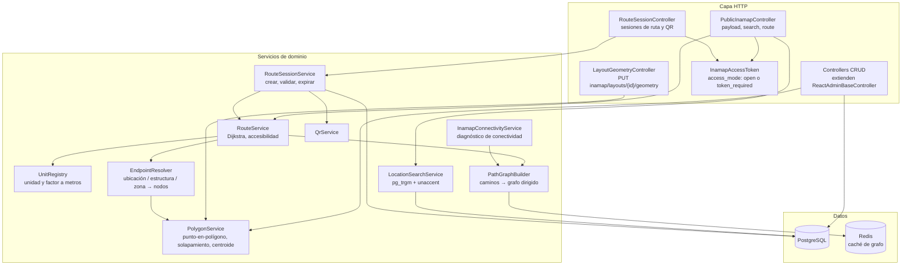

## 3.4 Modelo de coordenadas, unidades e identificadores

| Decisión | Detalle | Motivo |
|---|---|---|
| Unidad | Cada inamap declara su `unit`. **v1 habilita solo `m` (metros).** El registro `config('inamap.units')` define `{código: {to_meters, enabled}}`; agregar otra unidad (p. ej. pies) es agregar una entrada, sin migrar geometría | Requerimiento: metros inicialmente, agnóstico a la unidad a futuro |
| Plano | Cartesiano; origen `(0,0)` en la esquina **superior izquierda** del layout; `y` crece hacia abajo | Coincide con el canvas del navegador; evita inversiones de eje |
| Almacenamiento | La geometría se guarda **en la unidad del inamap**, nunca en píxeles | Cambiar/re-escalar la imagen de fondo no corrompe zonas ni caminos |
| Imagen ↔ plano | Cada layout define `width` y `height` (en la unidad del inamap); la imagen se estira a ese rectángulo | Un layout = un rectángulo + imagen |
| Polígono | `json` `[[x,y],…]`, ≥ 3 vértices, simple (sin autointersección), orientación libre | Validado por la regla `PolygonIsSimple` |
| Camino | `json` `[[x,y],…]`, ≥ 2 vértices | Polilínea |
| Tolerancia | `inamap.snap_tolerance_m` (def. `0.30` m, convertida a la unidad del inamap) | Dos vértices a menos de la tolerancia se consideran el mismo nodo |
| Precisión | `decimal(12,4)`; valores redondeados al milímetro equivalente | Evita falsos "no conectado" por ruido numérico |
| Identificadores | **Todas las claves primarias son UUID** (`uuid('id')->primary()`, modelos con `HasUuids`), incluidas las sesiones de ruta | Consistencia con `tenant_id`; ids no secuenciales y seguros de exponer |

## 3.5 Motor de rutas

### Construcción del grafo (por inamap)

1. **Nodos:** cada vértice de cada camino. Vértices dentro de la tolerancia (incluso de caminos distintos) se **fusionan** en un solo nodo.
2. **Aristas intra-camino:** entre vértices consecutivos, con peso = distancia euclidiana. La **dirección** del camino filtra el sentido:
   - `forward` → solo del primer al último vértice;
   - `backward` → solo del último al primero;
   - `both` → ambos sentidos.
3. **Enlaces explícitos** (`inamap_path_links`): arista entre un extremo de un camino y un extremo de otro, aunque no coincidan geométricamente.
   - `kind = link`: misma planta (línea punteada en la UI).
   - `kind = vertical`: entre layouts distintos. **Debe declarar `vertical_type`** (ver tabla).
   - `cost` opcional; si falta se usa el `default_cost` del tipo.
4. **Caché:** el grafo serializado se guarda por inamap en Redis y se invalida con cualquier escritura en caminos, enlaces o layouts (`GraphInvalidationObserver`).

**Tipos de enlace vertical** (`config('inamap.vertical_types')`):

| `vertical_type` | Accesible | Costo por defecto (equiv. m) | Comentario |
|---|---|---|---|
| `elevator` | Sí | 15 | Ascensor |
| `ramp` | Sí | 5 | Rampa entre niveles |
| `stairs` | **No** | 8 | Escalera fija |
| `escalator` | **No** | 6 | Escalera mecánica |

Con `accessible=true` la ruta **excluye** los tipos no accesibles. Si el destino queda inalcanzable solo por esa restricción, la respuesta es `UNREACHABLE_ACCESSIBLE` (distinto de `UNREACHABLE`).

### Resolución de origen/destino (`EndpointResolver`)

| Tipo | Resolución |
|---|---|
| `location` | Se proyecta al punto más cercano de un camino del **mismo layout** (nodo virtual con aristas a los extremos del segmento, respetando dirección). |
| `structure` / `zone` | Fuente/sumidero **múltiple**: nodos del grafo que caen dentro del polígono o a ≤ tolerancia de su borde; si no hay, el nodo más cercano al centroide. El destino resultante es el de menor costo. |
| Sin camino cercano | Error tipificado `NO_PATH_NEAR_ENDPOINT` (y el diagnóstico lo reporta en el editor). |

### Búsqueda de ruta y respuesta

- Algoritmo: **Dijkstra** sobre grafo dirigido ponderado (escala esperada ≪ 10⁴ nodos; A* no justifica su complejidad).
- **Tiempo estimado** = `distancia (en metros) / velocidad`. La velocidad proviene del **tenant setting** `inamap_walking_speed_mps` (def. **1.2 m/s**, valor de plataforma en `config/tenant_settings.php`, editable por el administrador del tenant en `inamap-web`).
- Respuesta JSON: `distance`, `unit`, `estimated_seconds`, `accessible`, y `steps[]` donde cada paso es **un tramo por layout**: `{layout_id, layout_name, points[], distance, transition?: {kind:'vertical', vertical_type, to_layout_id}}`.
- Errores tipificados: `UNREACHABLE`, `UNREACHABLE_ACCESSIBLE`, `NO_PATH_NEAR_ENDPOINT`, `ENDPOINT_NOT_FOUND`, `INAMAP_NOT_PUBLISHED`.

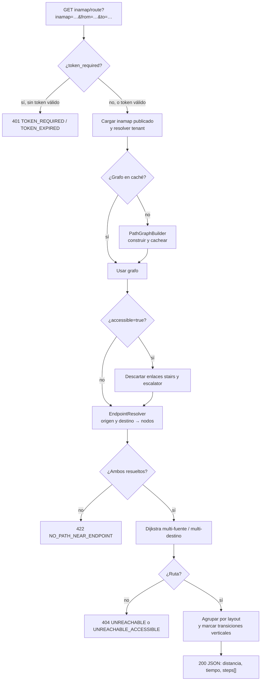

## 3.6 Seguridad, permisos, acceso público y sesiones de ruta

**Aislamiento por tenant.** Todas las tablas de negocio llevan `tenancy_id` y `tenant_id`. `InamapBaseController::_setup()` acota la consulta con el scope `visibleTo($user)` **antes** de cualquier operación (listar, leer, actualizar, eliminar, operaciones masivas), de modo que una fila ajena simplemente no existe (404). Reglas (`TenantContext`, mismo criterio que el resto del framework):

| Rol | Ve | Crea en |
|---|---|---|
| SystemAdmin | Todo, o el tenant de `X-Tenant-Id` / `tenant_id` | El tenant indicado |
| TenancyAdmin | Su tenancy; con `X-Tenant-Id` (TenantSwitcher) solo ese tenant, **validado** contra su tenancy (un encabezado ajeno no amplía nada: falla cerrado) | El tenant activo o el `tenant_id` indicado, si es de su tenancy |
| Tenant / User | Su tenant (y categorías de alcance tenancy) | Su tenant |

Las consultas públicas resuelven el tenant **desde el inamap** (`id`), nunca desde parámetros del cliente.

**Permisos.** Convención `route_name` del framework (`api.inamaps.*`, `api.inamap.<entidad>.<acción>`), sembrados con JSON (primera vez) y, para cambios posteriores, `PermissionMigration` (skill `dashadmin-permissions`).

| Recurso | SystemAdmin | TenancyAdmin | TenantAdmin | Editor | Visitante |
|---|---|---|---|---|---|
| Inamaps (CRUD) | ✔ | ✔ (sus tenants) | ✔ | Leer / editar | — |
| Publicar / despublicar inamap | ✔ | ✔ | ✔ | — | — |
| Configuración del inamap (`access_mode`, `access_key`) | ✔ | ✔ | ✔ | — | — |
| Layouts (CRUD + imagen) | ✔ | ✔ | ✔ | ✔ | — |
| Zonas / estructuras / ubicaciones / caminos / enlaces | ✔ | ✔ | ✔ | ✔ | — |
| Categorías | ✔ | ✔ | ✔ | Leer | — |
| Diagnóstico de conectividad / QR | ✔ | ✔ | ✔ | ✔ | — |
| API pública (payload, búsqueda, ruta, sesiones) | — | — | — | — | ✔ (solo inamaps publicados; según `access_mode`) |
| Tenancies, tenants, usuarios, planes | ✔ | ✔ (su alcance) | Tenant propio | — | — |

### Modos de acceso del visor (`inamap.settings.access_mode`)

| Modo | Comportamiento |
|---|---|
| `open` (def.) | Payload, búsqueda y ruta son públicos (sujetos a `throttle`). El token es **opcional** y solo sirve para llevar una ruta concreta al dispositivo del usuario. |
| `token_required` | Payload, búsqueda y ruta exigen cabecera `X-Inamap-Token` válida y emitida para **ese** inamap. Sin token → `401 TOKEN_REQUIRED`; vencido → `401 TOKEN_EXPIRED`; de otro inamap → `401 TOKEN_INVALID`. |

### Sesiones de ruta y QR

Una **sesión de ruta** es un registro en servidor que congela una ruta calculada y la expone mediante un token opaco y un **código QR**, para que el usuario vea el inamap con su ruta en su propio dispositivo.

- **Creación:** `POST api/inamap/route-sessions {inamap, from, to, accessible?}`. El servidor calcula la ruta, la persiste y responde `{session_id, token, view_url, qr_svg, expires_at}`. El token en claro se entrega **una sola vez**; en BD solo se guarda su hash (SHA-256).
- **QR:** codifica `view_url = {APP_URL}/inamap/{id}#t={token}`. El token va en el *fragmento* (`#`), que el navegador no envía al servidor ni queda en logs de acceso. El QR no contiene datos personales.
- **Consumo:** `inamap-app` lee el fragmento y llama a `GET api/inamap/route-sessions/current` con `X-Inamap-Token`; recibe el payload del inamap y la ruta ya trazada.
- **Quién puede crear sesiones en `token_required`:** un dispositivo/integración con la **`access_key`** del inamap (cabecera `X-Inamap-Access-Key`, rotable por el administrador; se muestra una sola vez y se guarda hasheada) o un usuario autenticado del tenant. En `open`, cualquier visitante.
- **Vida útil:** `session_ttl_minutes` (def. 60, configurable en los ajustes del inamap). Comando programado `PruneRouteSessionsCommand` elimina sesiones vencidas.
- **Reutilización:** el mismo token puede abrirse en varios dispositivos hasta que expire.
- **Protecciones:** `throttle` por IP y por inamap en creación y consumo, límite de sesiones activas por inamap, tokens de 256 bits, comparación en tiempo constante.

**CORS y caché:** CORS administrado con `domain-config-layers`; cabeceras `Cache-Control`/`ETag` en el payload solo en modo `open` (en `token_required` el payload no se cachea de forma pública).

## 3.7 Aprovisionamiento, límites de plan y ajustes

- **`TenantProvisioningJob`** (listener del core, H12): al crearse un tenant, siembra categorías por defecto (Baños, Accesos, Servicios, Salidas de emergencia, Información) y, opcionalmente, un inamap de ejemplo.
- **Límites de plan** (JSON del `SubscriptionPlan`, `0/null/-1` = ilimitado, SystemAdmin exento): `max_tenants`, `max_inamaps`, `max_layouts_per_inamap`, `max_locations`, `max_active_route_sessions`. `max_tenants` lo hace cumplir el core. Las claves propias del dominio las aplica `InamapPlanLimits`: reutiliza `PlanLimitsService::getPlanLimits()` (lectura del plan), su bypass de SystemAdmin y `SubscriptionLimitExceededException` (403), pero **cuenta en el dominio**, porque `PlanLimitsService::getCurrentCount()` devuelve 0 para claves que no conoce y nunca las haría cumplir. Si el plan no define una clave se usa `config('inamap.plan_limit_defaults')`.
- **Plan de prueba (trial) por defecto:** `max_tenants = 1`, `max_inamaps = 1`.
- **Tenant settings** (`config/tenant_settings.php`): `inamap_walking_speed_mps` (def. 1.2). Los ajustes por inamap (`access_mode`, `session_ttl_minutes`, marca, centro/zoom inicial) viven en `inamaps.settings`.

## 3.8 Estrategia de pruebas (backend)

| Nivel | Qué cubre |
|---|---|
| Unitarias | `PolygonService` (contención, solapamiento zona-zona bloqueado, estructura-zona permitido, estructura-estructura advertencia, borde compartido), `RouteService` (sentido único, enlace vertical por tipo, `accessible`, inalcanzable), `PathGraphBuilder` (fusión por tolerancia), `UnitRegistry` (conversión) |
| Feature | CRUD por entidad con aislamiento entre tenants; regla de no-solapamiento (422); guardado atómico de layout (todo o nada); permisos por rol; límites de plan (trial = 1 tenant, 1 inamap); velocidad peatonal desde tenant settings |
| API pública | Inamap no publicado → 404; inamap de otro tenant inaccesible; búsqueda difusa (acentos, typos); ruta entre layouts; `throttle` |
| Sesiones de ruta | Creación y QR; token solo hasheado; expiración; token de otro inamap rechazado; `token_required` sin token → 401; `access_key` inválida; poda de vencidas |
| Regresión de core | `--testsuite Core` sin cambios (el dominio no debe romper el core) |

---

# PARTE 4 — Arquitectura frontend

## 4.1 Mapa de aplicaciones (patrón del framework: system / web / app)

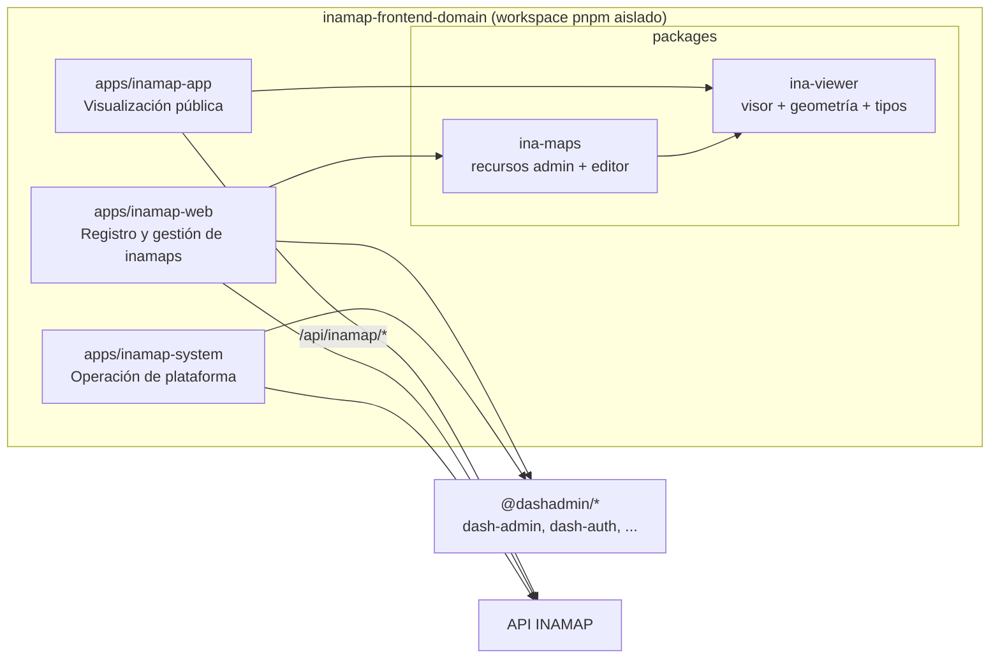

| App | Audiencia | Propósito | Autenticación | Contenido |
|---|---|---|---|---|
| **`inamap-system`** | Administrador de sistema | Funciones de **gestión de tenancy** y operación de la plataforma | Sí (`SystemAdmin`) | Tenancies, tenants, usuarios, roles/permisos, planes de suscripción y límites, pasarelas de pago, auditoría/logs, estadísticas globales |
| **`inamap-web`** | Clientes (tenants) y sus equipos | **Registro** de tenants y **gestión de inamaps** | Sí (`TenantAdmin`, `TenancyAdmin`, Editor) + registro público | Registro/trial, onboarding, inamaps, layouts, editor de canvas, categorías, usuarios del tenant, publicación, ajustes de acceso (modo, `access_key`), QR, plan/suscripción, ajustes del tenant |
| **`inamap-app`** | Visitantes | **Servir los inamaps** al usuario final | No (público; token opcional u obligatorio según el inamap) | Visor, búsqueda, selector origen/destino, ruta animada, cambio de piso, ruta accesible, ficha de ubicación, apertura de ruta desde QR |

> **Decisión de diseño:** en este dominio la "app" es **pública y ligera**; la gestión autenticada vive en `inamap-web`. Por eso el visor se separa en un paquete sin dependencia de `react-admin` (`ina-viewer`).

## 4.2 Paquetes de dominio `ina-*`

> Las apps INAMAP no dependen de paquetes de otros dominios: lo reutilizable vive en un paquete `ina-*`.

| Paquete | Dependencias clave | Contenido |
|---|---|---|
| **`ina-viewer`** | React. **Sin** `react-admin` | `MapCanvas` (dibujo SVG compartido por editor y visor), `InamapViewer` (visor completo: búsqueda, ruta accesible, pisos, ficha, QR), `SearchBox`, tipos y geometría, cliente de la API pública (con `X-Inamap-Token`), textos propios |
| **`ina-common`** | `react-admin`, `dash-admin` | Piezas de plataforma reutilizadas por las apps: utilidades de los providers, `TenantImage`, paletas, páginas de registro/alta/legal, ícono del cargador |
| **`ina-maps`** | `react-admin`, `dash-admin`, `ina-viewer` | Recursos (`inamapResources`: inamaps con el editor como vista "show" y categorías con el árbol arrastrable; `reportResources`), **`InamapEditor`**, `useInamapApi`, i18n registrado en tiempo de ejecución |

Los tres siguen la receta `frontend-new-package`: `tsup` con `bundle:false`, mapa `exports` comodín + `typesVersions`, sin re-declarar dependencias del workspace, traducciones registradas de forma progresiva (`dashadmin-i18n`), y *source-aliasing* automático en desarrollo (`localPackageSrcAliases.mts`).

## 4.3 Editor de mapas (`InamapEditor`)

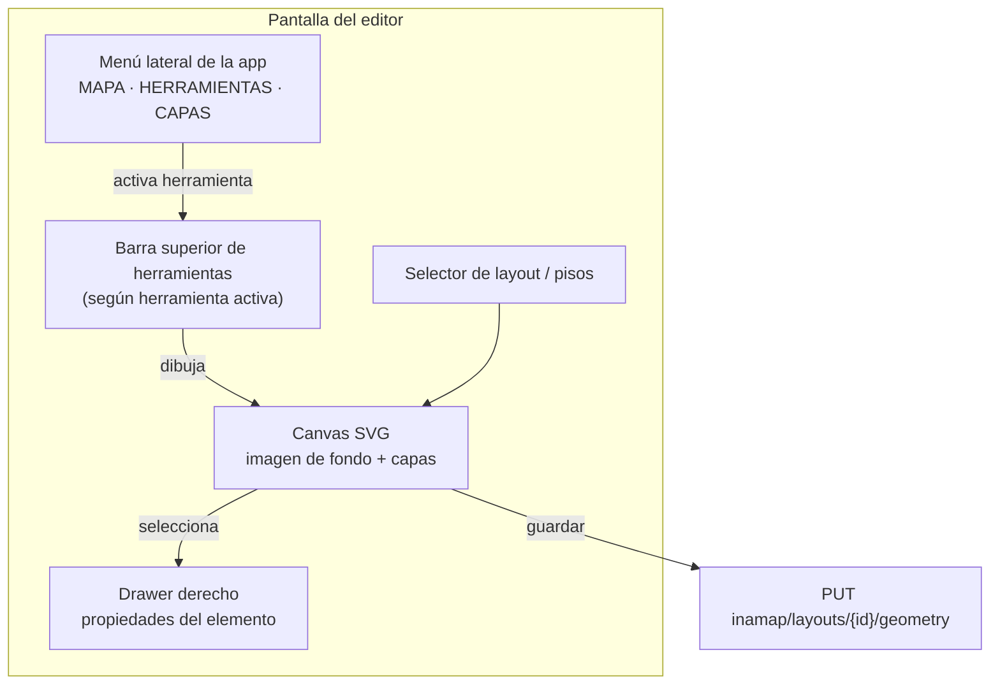

- **Ubicación en la app:** vista "show" del recurso inamaps, a pantalla completa. Las secciones MAPA (Información, Editor, Layouts, Configuración), HERRAMIENTAS y CAPAS se integran en el **menú lateral de la app** (debajo de los recursos); Propiedades, Layouts, Información y Configuración se abren como **drawers a la derecha**, como los ajustes de laboratorio del framework.
- **Render:** SVG (suficiente para polígonos/polilíneas de este volumen; animación de ruta trivial). Decisión revisable si se superan ~5 000 elementos por layout.
- **Capas (z-order):** imagen de fondo → zonas (translúcidas) → estructuras (sólidas) → caminos → ubicaciones → ruta calculada.
- **Herramientas:** *Zona* y *Estructura* (dibujo de polígono, edición de vértices, color y etiqueta), *Ubicación* (clic sobre el plano, ícono, metadata), *Camino* (polilínea, sentido), *Enlace* (arrastrar entre extremos; línea punteada; para enlaces verticales, selector de layout destino y de **tipo**: ascensor, rampa, escalera, escalera mecánica), *Medir* (en la unidad del inamap).
- **Validación en vivo:** el solapamiento de zonas se resalta en rojo (bloquea); estructura-estructura se resalta en ámbar (advertencia). La validación **autoritativa** es la del servidor (422).
- **Estado:** el editor trabaja sobre un documento de layout en memoria con deshacer/rehacer; el guardado es atómico (§9).
- **Diagnóstico:** botón "Verificar conectividad" muestra ubicaciones inalcanzables y caminos sueltos.

## 4.4 Visor público (`InamapViewer`)

- Carga el payload del inamap publicado una vez; búsqueda y ruta se piden bajo demanda.
- Campos **Origen** y **Destino** con autocompletado difuso (zonas, estructuras, ubicaciones de cualquier layout); filtro por categoría; interruptor **"Ruta accesible"**.
- Dibuja la ruta por layout, con control para pasar de piso al llegar a un enlace vertical (indica el tipo: ascensor, rampa, escalera).
- Si el inamap es `token_required`, el visor lee el token del fragmento de la URL (`#t=…`), lo conserva en memoria y lo envía en `X-Inamap-Token`; sin token muestra una pantalla "escanee el código QR del recinto".
- Botón **"Ver en mi dispositivo"**: crea una sesión de ruta y muestra su QR (`RouteSessionQr`).
- Modo *embebible*: `<iframe src="…/inamap/{id}">` o *web component* (evolución); ficha con QR y enlace.

## 4.5 Patrones del framework que se mantienen

| Patrón | Aplicación en INAMAP |
|---|---|
| **Manifiesto de recursos** (`ResourceManifest` + `loadResourcesFromManifest`) | Cada app lazy-load de sus recursos; `inamap-web` separa manifiesto *tenancy-level* y *tenant-level*. |
| **TenantSwitcher** | `TenancyAdmin` cambia de tenant en `inamap-web`; persiste `last_active_tenant_id` vía `TenancyContextService`. |
| **Constantes por app** | Cada app tiene su `.env` y `FRONTEND_URL` propios (skill `dash-admin-envs-constants`): atención a URLs cruzadas (el QR apunta a `inamap-app`; el backend necesita su URL en `APP_URL`/`INAMAP_APP_URL`). |
| **Formularios** | `DashAutoForm`/Resource+Schema (skill `dashadmin-forms`); subida de imagen con `ImageInput` (skill `dashadmin-images`). |
| **Ajustes de tenant** | Pestaña de ajustes con `inamap_walking_speed_mps` (skill `dashadmin-tenantsettings`). |
| **i18n** | `es` primario, `en` secundario; claves en el paquete dueño de las cadenas. |
| **Dependencia publicada** | `@dashadmin/*` se consume por npm, no por enlace de workspace; `LINK_DASH_CORE=true` solo para desarrollo del framework. |

## 4.6 Configuración de build y scripts

- Variables por app: `apps/<app>/.env.<app>.<entorno>` (apps DashAdmin, elegidas con `CUSTOM_MODE`) y `apps/inamap-app/.env.local`.
- Scripts raíz: `dev:web`, `dev:system`, `dev:app`, `build:packages`, `build:web`, `build:system`, `build:app`, `build`, `test`, `typecheck` (`INAMAP_ENV=<entorno>` para compilar otro entorno).
- `vite.config.mts` por app con `define` de variables `VITE_*` y alias de paquetes locales.
- Guía completa: `inamap-documentation/desarrollo/03-frontend.md`.

---

# PARTE 5 — Runtime, entornos y despliegue

## 5.1 Repositorio de runtime aislado: `inamap-backend-docker`

INAMAP tiene su **propio** repositorio de runtime, separado del runtime compartido del
framework, para entregarlo solo a los desarrolladores de este proyecto con lo esencial.
Corre el core desde una **imagen publicada** (no requiere el código fuente del core) y
monta el dominio desde la carpeta hermana. Instrucciones completas en
`inamap-backend-docker/README.md`.

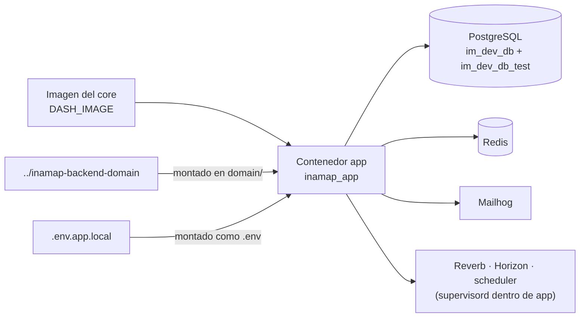

| Archivo | Rol |
|---|---|
| `docker-compose.yml` | Stack autocontenido: app, PostgreSQL, Redis, Mailhog. Ningún montaje desde `../dash-backend`. |
| `docker-compose.core-dev.yml` | Overlay opcional que monta el código del core (solo equipo del core). |
| `inamap.sh` | `init` (genera `.env` y `.env.app.local` con secretos nuevos), `up`, `down`, `logs`, `migrate`, `seed`, `test`, `artisan`, `shell`. |
| `.env.example` / `.env.app.example` | Plantillas sin secretos (las únicas que van a git). |
| `docker/pgsql/create-testing-db.sh` | Crea la base principal y la de pruebas. |

## 5.2 Parámetros

| Parámetro | Valor |
|---|---|
| Proyecto Compose | `inamap` (contenedores `inamap_*`) |
| API local | `25200` |
| Reverb | `27001` |
| PostgreSQL | `25434` |
| Redis | `25389` |
| Mailhog SMTP / UI | `25029` / `25030` |
| Base de datos / usuario | `im_dev_db` (pruebas: `im_dev_db_test`) / `im` |
| Visor (`INAMAP_APP_URL`) / panel (`FRONTEND_URL`) | `http://localhost:5180` / `http://localhost:5181` |

> Cada desarrollador genera sus propios secretos con `./inamap.sh init`; nunca se reutilizan
> los de otros proyectos.

## 5.3 Arranque y reglas

```bash
./inamap.sh init     # una vez
./inamap.sh up       # levanta, migra y siembra roles/permisos la primera vez
./inamap.sh test     # suite Domain
```

- **Nunca** `migrate:fresh` / `migrate:refresh` / `db:wipe` sobre la base de desarrollo; solo `./inamap.sh migrate`.
- La suite de pruebas usa `im_dev_db_test`; el `TestCase` del core la migra y siembra (`RefreshDatabase`).
- Staging/preview: cuando se defina el dominio (S6), se decidirá si INAMAP se suma al despliegue automático del runtime compartido o tiene el suyo.

## 5.4 Despliegue (fuera de v1)

Producción replicará el patrón de CDK del framework (ECS Fargate + ALB + RDS + Valkey, imagen core + dominio horneado). Se especificará en un documento separado (`inamap-ci-cdk`). No está dentro del alcance el despliegue escalable a producción en esta etapa.

---

# PARTE 6 — Requerimientos funcionales e historias de usuario

## 6.1 Requerimientos funcionales

### Gestión de inamaps y layouts
| ID | Requerimiento |
|---|---|
| RF-01 | El sistema debe permitir crear, editar, listar y eliminar **inamaps**, cada uno asociado a un sistema de coordenadas con una unidad (v1: metros). |
| RF-02 | Un inamap debe poder contener **múltiples layouts** (p. ej. pisos), ordenables por nivel. |
| RF-03 | Cada layout debe permitir **subir una imagen de fondo propia** y definir sus dimensiones reales (`width`, `height`). |
| RF-04 | El inamap debe tener estado **borrador/publicado**; solo los publicados son visibles en la API pública. |
| RF-33 | El sistema debe soportar **unidades de medida configurables por inamap** mediante un registro extensible (v1 habilita solo metros). |

### Geometría
| ID | Requerimiento |
|---|---|
| RF-05 | El sistema debe permitir administrar **zonas**: polígonos sobre el layout con color, etiqueta y código. |
| RF-06 | Las zonas **no pueden solaparse** dentro del mismo layout (borde compartido permitido). |
| RF-07 | El sistema debe permitir administrar **estructuras**: polígonos de superficie sólida con color, etiqueta y código (edificios, pabellones). Pueden solaparse con zonas; el solapamiento entre estructuras emite **advertencia no bloqueante**. |
| RF-08 | Una estructura puede **contener ubicaciones**. |
| RF-09 | El sistema debe permitir administrar **ubicaciones**: punto en el plano con etiqueta, código, ícono, categoría, metadata y **código QR** que enlaza a un sitio web. |
| RF-10 | Zonas, estructuras y ubicaciones deben admitir **términos de búsqueda** (`terms`) en su metadata. |
| RF-11 | El sistema debe permitir administrar **categorías** y asignar una a cada ubicación. |

### Caminos y rutas
| ID | Requerimiento |
|---|---|
| RF-12 | El sistema debe permitir dibujar **caminos** como polilíneas libres sobre el layout. |
| RF-13 | Cada camino debe tener **dirección** de circulación (`forward`, `backward`, `both`). |
| RF-14 | Los caminos pueden conectarse por **vértices coincidentes** o por **enlaces explícitos** (línea punteada en la UI). |
| RF-15 | Un camino puede enlazarse con otro de **otro layout** mediante un enlace vertical **tipado**: ascensor, rampa, escalera o escalera mecánica. |
| RF-16 | El sistema debe **calcular la ruta óptima** entre origen y destino respetando las direcciones. |
| RF-17 | Origen y destino pueden ser **ubicación, estructura o zona**, en cualquier layout. |
| RF-18 | El sistema debe ofrecer un **diagnóstico de conectividad** que identifique ubicaciones inalcanzables y caminos aislados. |
| RF-34 | El cálculo de ruta debe admitir **modo accesible**, excluyendo escaleras y escaleras mecánicas. |
| RF-35 | El tiempo estimado debe calcularse con la **velocidad peatonal del tenant** (def. 1.2 m/s), configurable en los ajustes del tenant. |

### Búsqueda y API pública
| ID | Requerimiento |
|---|---|
| RF-19 | El sistema debe ofrecer **búsqueda difusa** por términos libres sobre etiquetas, códigos, términos, categoría y metadata, devolviendo el tipo (zona/estructura/ubicación). |
| RF-20 | La búsqueda debe poder **filtrarse por categoría**. |
| RF-21 | La API debe responder en **JSON**. |
| RF-22 | Debe existir un **endpoint público** del inamap (`/inamap/{id}`) para desplegar un visor HTML con zonas, estructuras y ubicaciones sobre la imagen de fondo, con indicaciones A→B. |

### Acceso y sesiones de ruta
| ID | Requerimiento |
|---|---|
| RF-29 | La configuración del inamap debe permitir definir el **modo de acceso** del visor: `open` o `token_required`. |
| RF-30 | El servidor debe poder **generar una sesión de ruta** (ruta calculada y persistida) que exponga un **token de identidad** y un **código QR**. |
| RF-31 | Al abrir el QR, el usuario debe ver el inamap y su **ruta ya trazada** en su dispositivo, sin repetir la búsqueda. |
| RF-32 | Las sesiones deben **expirar** (TTL configurable) y el token debe almacenarse solo como hash. |
| RF-36 | En `token_required`, la creación de sesiones debe exigir una **credencial de dispositivo** (`access_key`) rotable, o un usuario autenticado. |

### Plataforma (reuso del core)
| ID | Requerimiento |
|---|---|
| RF-23 | Un cliente debe poder **registrarse** (trial) y obtener su tenant en `inamap-web`. |
| RF-24 | El administrador de tenant debe gestionar **usuarios del tenant** y sus roles. |
| RF-25 | El administrador de tenancy debe **cambiar de tenant** y administrar varios. |
| RF-26 | El administrador de sistema debe gestionar **tenancies, tenants, planes y límites** en `inamap-system`. |
| RF-27 | El sistema debe hacer cumplir los **límites del plan** (tenants, inamaps, layouts, ubicaciones). El plan de prueba incluye **1 tenant y 1 inamap**. |
| RF-28 | El editor debe **guardar un layout de forma atómica** (zonas, estructuras, ubicaciones y caminos en una sola transacción). |

## 6.2 Historias de usuario

### Visitante (`inamap-app`)
| ID | Historia | Criterios de aceptación |
|---|---|---|
| HU-VIS-01 | Como visitante quiero abrir un inamap por su enlace/QR para orientarme en el recinto. | El inamap publicado carga con imagen, zonas, estructuras y ubicaciones. Uno no publicado responde "no disponible". |
| HU-VIS-02 | Como visitante quiero buscar un lugar escribiendo términos libres. | Tolera acentos y errores menores; muestra tipo y layout del resultado; vacío muestra "sin resultados". |
| HU-VIS-03 | Como visitante quiero filtrar la búsqueda por categoría (baños, accesos…). | El filtro limita resultados; combinable con texto. |
| HU-VIS-04 | Como visitante quiero elegir origen y destino y ver la ruta dibujada. | La ruta se muestra sobre el plano con distancia y tiempo estimado; respeta sentidos únicos. |
| HU-VIS-05 | Como visitante quiero que la ruta me indique cuando cambio de piso y por qué medio. | La ruta se divide por layout; hay botón para pasar al siguiente tramo; se indica el tipo (ascensor, rampa, escalera, escalera mecánica). |
| HU-VIS-06 | Como visitante quiero ver la ficha de una ubicación (nombre, categoría, enlace). | Ficha con metadata y botón "cómo llegar" que usa la ubicación como destino. |
| HU-VIS-07 | Como visitante quiero usar origen = zona o estructura. | La ruta se calcula hasta el borde/accesos del polígono. |
| HU-VIS-08 | Como visitante quiero que me avisen si no hay ruta. | Mensaje claro; distingue "no hay ruta" de "no hay ruta accesible". |
| HU-VIS-09 | Como visitante quiero escanear un QR de una ubicación y llegar a su sitio web. | El QR apunta a la URL configurada. |
| HU-VIS-10 | Como visitante con movilidad reducida quiero una ruta accesible. | Con el interruptor activo la ruta no usa escaleras ni escaleras mecánicas. |
| HU-VIS-11 | Como visitante quiero llevarme mi ruta al celular escaneando un QR. | Tras calcular la ruta aparece un QR; al abrirlo en el celular se ve el inamap con la ruta trazada. |
| HU-VIS-12 | Como visitante quiero un mensaje claro si mi enlace/QR venció. | Con `TOKEN_EXPIRED` se indica que debe escanear un código nuevo. |

### Editor de inamaps (`inamap-web`)
| ID | Historia | Criterios de aceptación |
|---|---|---|
| HU-EDI-01 | Como editor quiero subir la imagen de fondo de un layout. | Se acepta JPG/PNG/WebP con tamaño máx.; se previsualiza; se puede reemplazar sin perder geometría. |
| HU-EDI-02 | Como editor quiero dibujar zonas con color y etiqueta. | El polígono se cierra con ≥ 3 vértices; editable; color y código persistentes. |
| HU-EDI-03 | Como editor quiero que el sistema impida zonas solapadas. | Al solapar, se resalta y el guardado devuelve 422 con las zonas en conflicto. |
| HU-EDI-04 | Como editor quiero dibujar estructuras sólidas. | Igual que zonas, con relleno sólido y color; pueden cruzarse con zonas; el cruce entre estructuras muestra advertencia no bloqueante. |
| HU-EDI-05 | Como editor quiero insertar ubicaciones con clic en el plano. | Aparece ícono; el panel derecho edita etiqueta, código, categoría, ícono, términos y URL. |
| HU-EDI-06 | Como editor quiero asignar una ubicación a una estructura. | Selector de estructura; filtra por layout. |
| HU-EDI-07 | Como editor quiero dibujar caminos y definir su sentido. | Polilínea con flechas de dirección; cambio de sentido inmediato. |
| HU-EDI-08 | Como editor quiero unir caminos con un enlace cuando no se tocan. | Se muestra línea punteada; el enlace se usa en el cálculo de rutas. |
| HU-EDI-09 | Como editor quiero unir un camino con otro layout indicando el tipo (ascensor, rampa, escalera, escalera mecánica). | Selector de layout, camino destino y **tipo obligatorio**; costo opcional (por defecto el del tipo). |
| HU-EDI-10 | Como editor quiero verificar la conectividad de mi inamap. | Lista ubicaciones inalcanzables (con y sin modo accesible) y caminos aislados con navegación al elemento. |
| HU-EDI-11 | Como editor quiero probar una ruta antes de publicar. | Vista previa autenticada sobre inamap en borrador. |
| HU-EDI-12 | Como editor quiero deshacer/rehacer y guardar todo de una vez. | Guardado atómico; si falla nada se aplica. |
| HU-EDI-13 | Como editor quiero generar e imprimir el QR de una ubicación. | Descarga PNG/SVG con la URL configurada. |
| HU-EDI-14 | Como editor quiero importar/duplicar un inamap o layout *(evolución)*. | Marcado como backlog (§10.4). |

### Administrador de tenant (`inamap-web`)
| ID | Historia | Criterios de aceptación |
|---|---|---|
| HU-TEN-01 | Como cliente quiero registrarme y crear mi cuenta. | Flujo trial del core; verificación de correo; tenant y usuario administrador creados. |
| HU-TEN-02 | Como administrador quiero crear inamaps y layouts dentro de mi plan. | Se bloquea con mensaje claro al exceder `max_inamaps`/`max_layouts_per_inamap`; el trial permite 1 inamap. |
| HU-TEN-03 | Como administrador quiero publicar/despublicar un inamap. | Cambia el estado; el enlace público refleja el cambio inmediato. |
| HU-TEN-04 | Como administrador quiero obtener el enlace y el código para embeber el visor. | Muestra URL pública, QR del inamap e `iframe` listo para copiar. |
| HU-TEN-05 | Como administrador quiero gestionar categorías. | CRUD; no se elimina una categoría en uso sin reasignar. |
| HU-TEN-06 | Como administrador quiero gestionar usuarios de mi tenant y sus permisos. | Crea editores con permisos acotados. |
| HU-TEN-07 | Como administrador quiero ver y cambiar mi plan. | Ve uso vs. límites; flujo de suscripción del core. |
| HU-TEN-08 | Como administrador quiero configurar la marca (logo, colores) del visor. | Colores/logo del tenant aplicados al visor público. |
| HU-TEN-09 | Como administrador quiero definir el modo de acceso del inamap y gestionar su `access_key`. | Selector `open`/`token_required`; TTL de sesión; la clave se muestra una vez y se puede rotar. |
| HU-TEN-10 | Como administrador quiero configurar la velocidad peatonal del tenant. | Ajuste numérico validado (> 0); se refleja en los tiempos estimados. |

### Administrador de tenancy (`inamap-web`)
| ID | Historia | Criterios de aceptación |
|---|---|---|
| HU-TCY-01 | Como administrador de tenancy quiero crear y administrar varios tenants. | Respeta `max_tenants` del plan. |
| HU-TCY-02 | Como administrador de tenancy quiero cambiar entre tenants. | `TenantSwitcher`; la preferencia persiste entre dispositivos. |
| HU-TCY-03 | Como administrador de tenancy quiero ver los inamaps de cualquiera de mis tenants. | Al cambiar de tenant se carga el manifiesto tenant-level. |

### Administrador de sistema (`inamap-system`)
| ID | Historia | Criterios de aceptación |
|---|---|---|
| HU-SYS-01 | Como administrador de sistema quiero gestionar tenancies y tenants. | CRUD completo con suspensión/reactivación. |
| HU-SYS-02 | Como administrador de sistema quiero definir planes y sus límites INAMAP. | Edita `max_tenants`, `max_inamaps`, `max_layouts_per_inamap`, `max_locations`, `max_active_route_sessions`. |
| HU-SYS-03 | Como administrador de sistema quiero gestionar usuarios, roles y permisos. | Catálogo `inamap.*` visible y asignable. |
| HU-SYS-04 | Como administrador de sistema quiero configurar pasarelas de pago. | Reuso del core. |
| HU-SYS-05 | Como administrador de sistema quiero auditar cambios y ver logs. | Bitácora del core (usuario, acción, entidad). |
| HU-SYS-06 | Como administrador de sistema quiero ver estadísticas globales (inamaps, ubicaciones, consultas, sesiones). | Tablero con totales por tenancy. |

## 6.3 Matriz de trazabilidad (resumen)

| Historias | RF | App | Endpoint principal |
|---|---|---|---|
| HU-VIS-01/06/09 | RF-09, RF-22 | app | `GET api/inamap/{id}` |
| HU-VIS-02/03 | RF-19, RF-20 | app | `GET api/inamap/search` |
| HU-VIS-04/05/07/08/10 | RF-16, RF-17, RF-34, RF-35 | app | `GET api/inamap/route` |
| HU-VIS-11/12 | RF-30, RF-31, RF-32 | app | `POST api/inamap/route-sessions`, `GET api/inamap/route-sessions/current` |
| HU-EDI-01/02/04/05/07 | RF-03, RF-05, RF-07, RF-09, RF-12/13 | web | `PUT api/inamap/layouts/{id}/geometry` |
| HU-EDI-03 | RF-06 | web | `PUT api/inamap/layouts/{id}/geometry` → 422 |
| HU-EDI-08/09 | RF-14, RF-15 | web | CRUD `api/inamap/path-links` |
| HU-EDI-10 | RF-18 | web | `GET api/inamaps/{id}/connectivity` |
| HU-TEN-01 | RF-23 | web | registro del core |
| HU-TEN-02 | RF-27 | web | CRUD `api/inamaps` + `InamapPlanLimits` |
| HU-TEN-03 | RF-04 | web | `POST api/inamaps/{id}/publish` |
| HU-TEN-09 | RF-29, RF-36 | web | `PUT api/inamaps/{id}` (settings), `POST api/inamaps/{id}/access-key/rotate` |
| HU-TEN-10 | RF-35 | web | tenant settings del core |
| HU-TCY-* | RF-25 | web | `PUT auth/active-tenant` (core) |
| HU-SYS-* | RF-26 | system | recursos del core |

---

# PARTE 7 — Modelo de datos (diagramas ER)

## ER-01 — Modelo de plataforma y dominio (visión general)

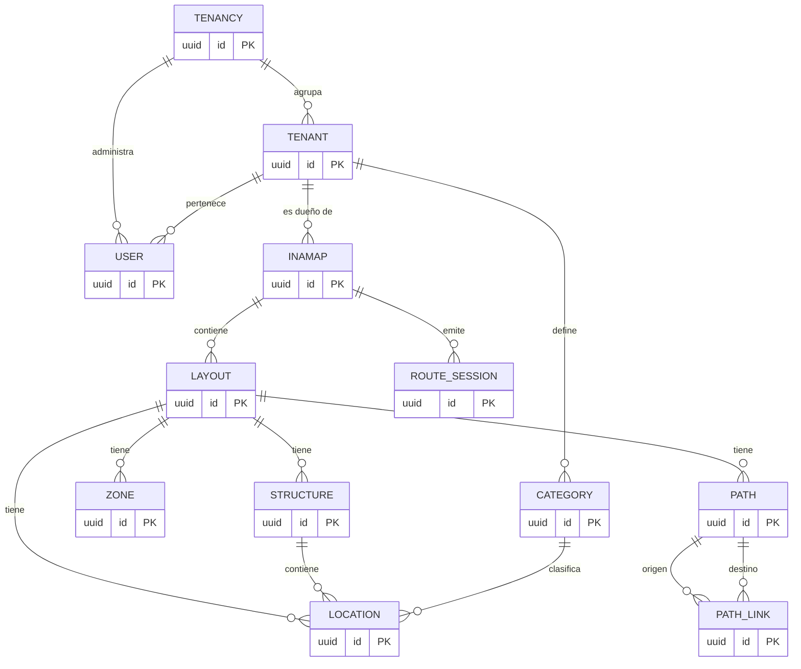

## ER-02 — Modelo funcional detallado del dominio

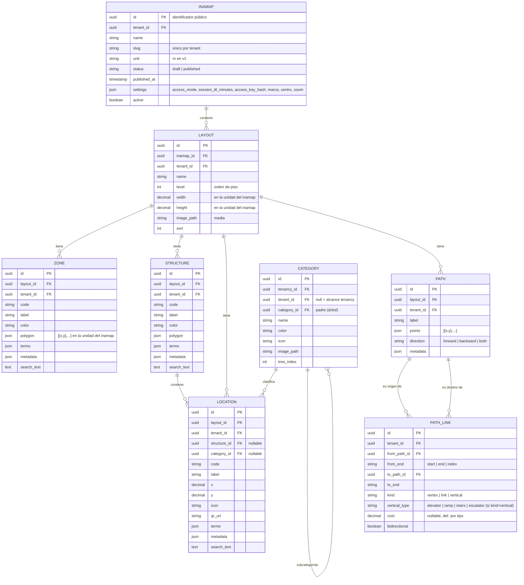

> **Columnas comunes no dibujadas:** todas las tablas llevan `tenancy_id` (el TenancyAdmin filtra por tenancy) y `tenant_id`; las hijas de un layout llevan además `inamap_id` denormalizado para que búsqueda, grafo y diagnóstico filtren sin joins. `search_text` se guarda ya normalizado (minúsculas, sin acentos), por lo que el índice trigram no necesita `unaccent`.
>
> **Categorías:** mismo modelo que las categorías de catálogo del framework — árbol por `category_id`, imagen, `tree_index`, `breadcrumbed_name` y filas de alcance tenancy (`tenant_id` null, visibles para todos los tenants de la tenancy). `getList` devuelve las raíces con su árbol salvo `flat=true`; `POST inamap/categories/updateTree` recibe el árbol editado.
>
> Prefijo de tablas: la raíz es `inamaps`; el resto `inamap_<entidad>` (`inamap_layouts`, `inamap_zones`, …) para evitar colisiones con el core. Eliminación **lógica** (`deleted_at`) en todas. Índices `gin (search_text gin_trgm_ops)` en zonas, estructuras y ubicaciones; compuestos `(tenant_id, inamap_id)`, `(layout_id)`, `(tenant_id, slug)` único. **Todas las PK son UUID.**

## ER-03 — Modelo conceptual del grafo de rutas (derivado, no persistido)

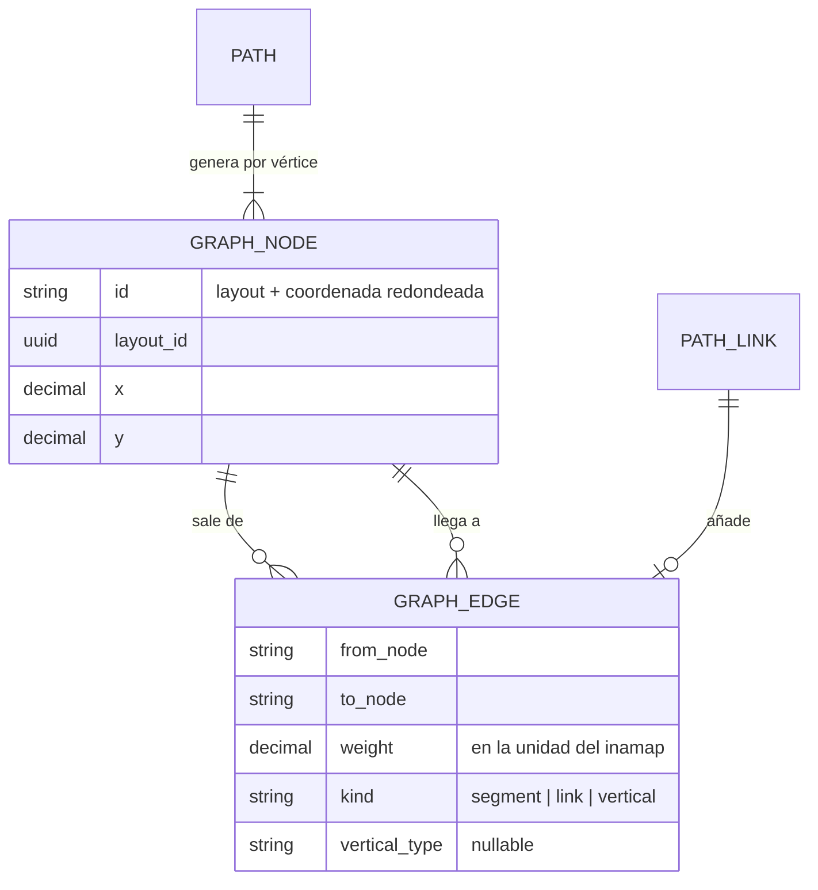

## ER-04 — Sesiones de ruta

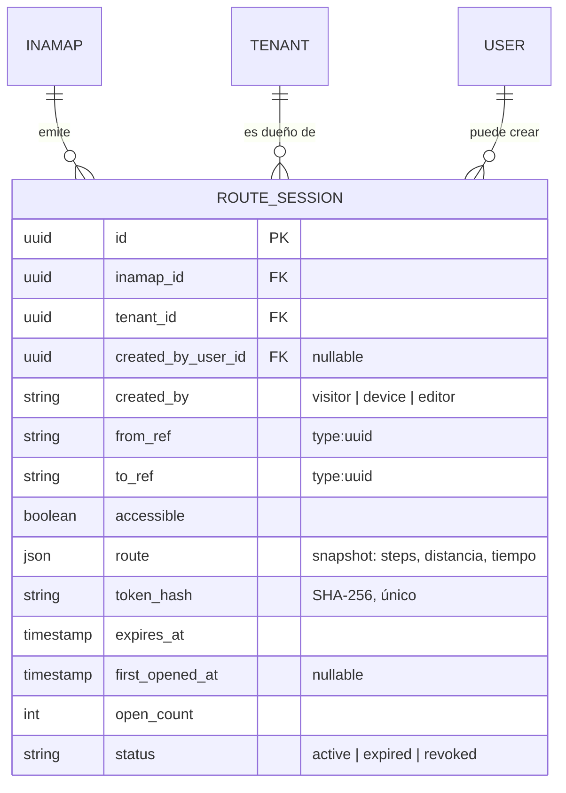

## 7.5 Reglas de integridad

| Regla | Dónde se aplica |
|---|---|
| Zonas de un mismo layout no se solapan (borde compartido permitido) | `NoZoneOverlap` en request + guardado atómico |
| Estructura↔zona puede solaparse; estructura↔estructura solo advierte | `PolygonService` → advertencias en la respuesta de guardado |
| Polígonos simples y con ≥ 3 vértices; caminos con ≥ 2 | `PolygonIsSimple` / validación de longitud |
| Geometría dentro de `[0,width]×[0,height]` | `PointInsideLayout` (advertencia si el layout cambia de tamaño) |
| Un `PATH_LINK` `vertical` une caminos de **layouts distintos del mismo inamap** y exige `vertical_type` | `PathLinkRequest` |
| Un enlace no puede unir caminos de inamaps o tenants distintos | `PathLinkRequest` + scoping |
| `unit` debe existir y estar `enabled` en `config('inamap.units')` | `InamapRequest` |
| `slug` único por tenant | Índice único |
| `token_hash` único; el token nunca se persiste en claro | `RouteSessionService` |
| Eliminar categoría en uso requiere reasignación | `CategoryPolicy`/controlador |
| Cualquier escritura en geometría invalida el grafo en caché | `GraphInvalidationObserver` |

---

# PARTE 8 — Flujos de usuario y de sistema

## FL-01 — Registro de un cliente y primer inamap

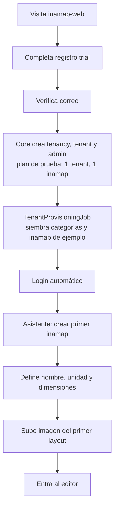

## FL-02 — Modelado de un layout en el editor

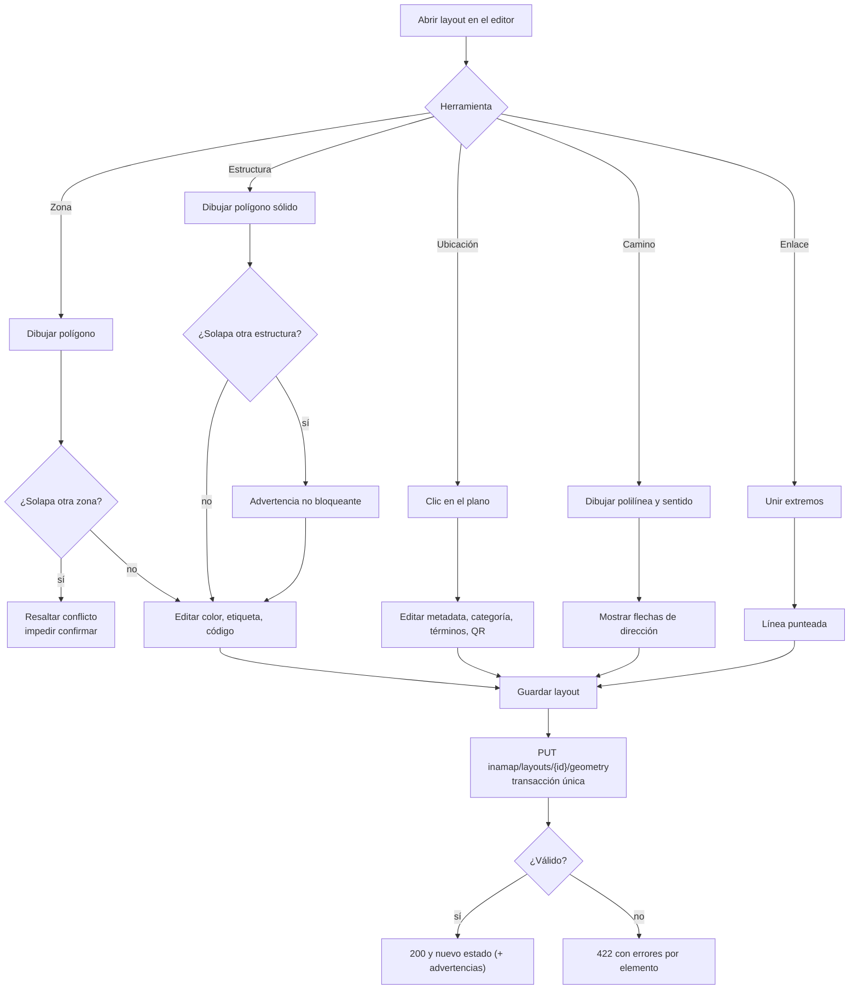

## FL-03 — Conexión entre pisos (ascensor, rampa o escalera)

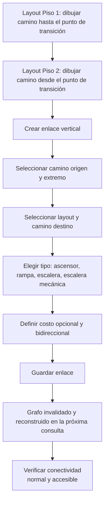

## FL-04 — Publicación de un inamap

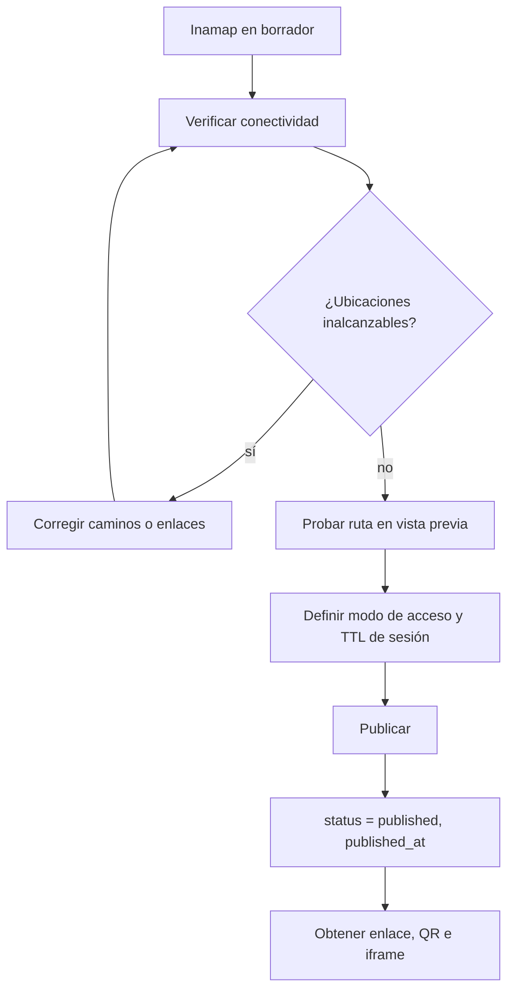

## FL-05 — El visitante busca y obtiene una ruta (modo `open`)

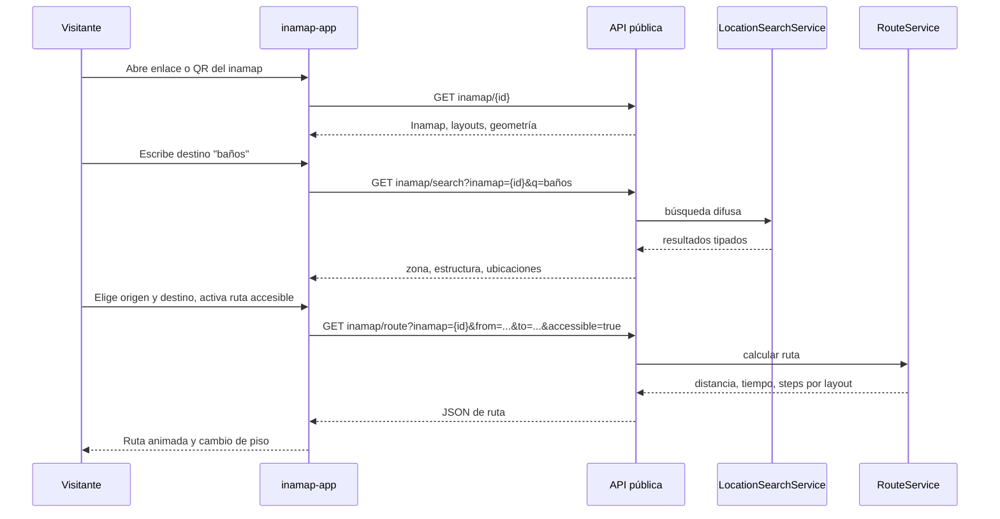

## FL-06 — Cambio de tenant de un administrador de tenancy

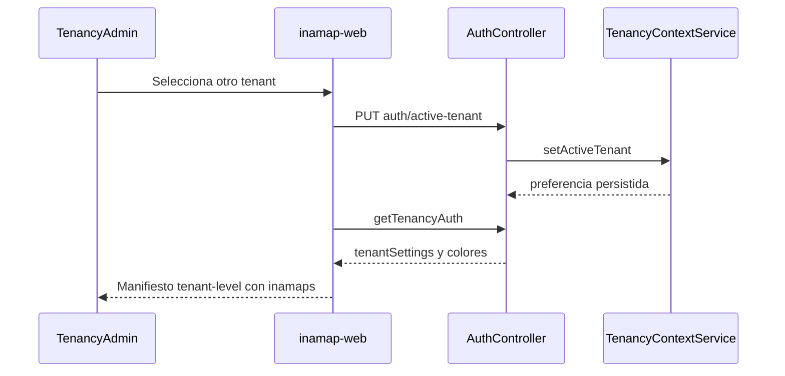

## FL-07 — Gestión de tenancies y planes (sistema)

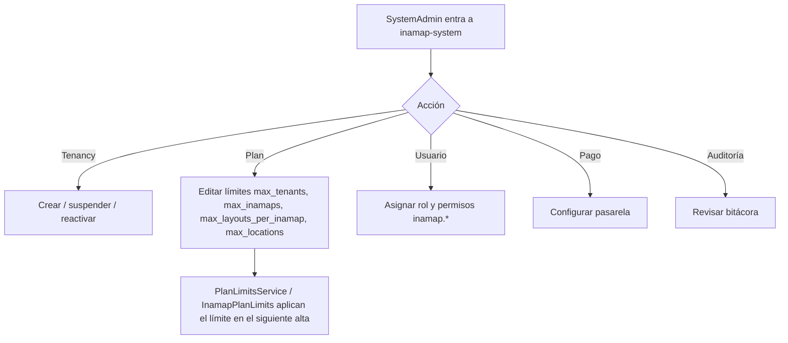

## FL-08 — Aplicación de límites de plan

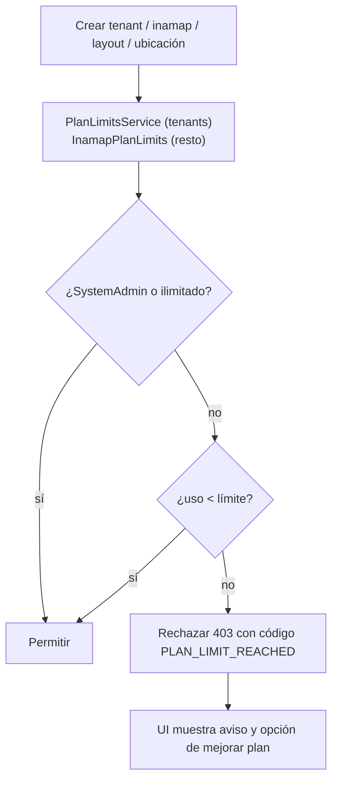

## FL-09 — Sesión de ruta y QR (llevar la ruta al celular)

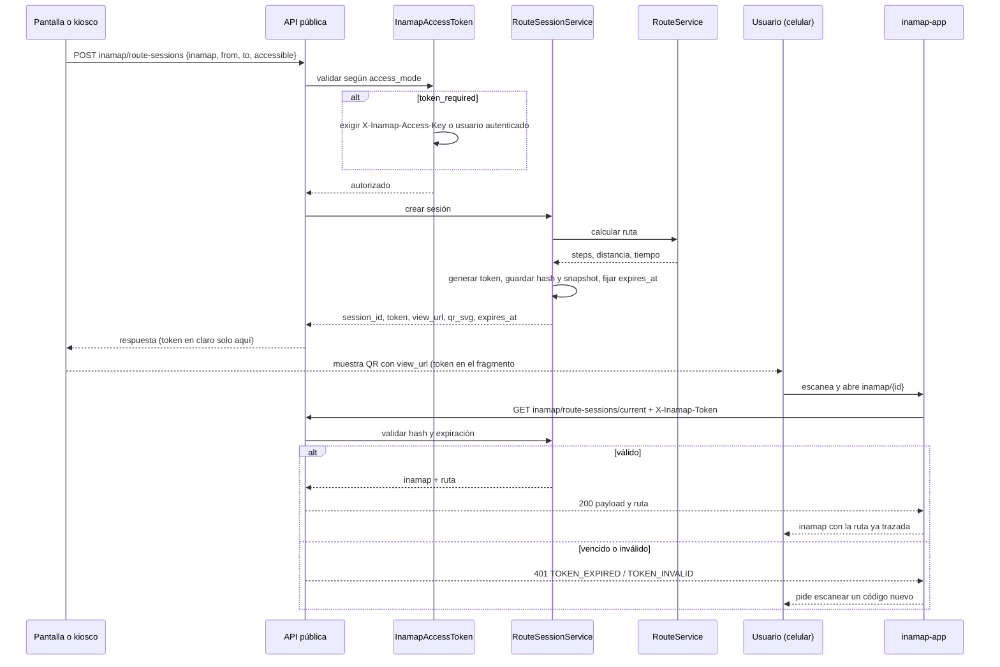

---

# PARTE 9 — Catálogo de API

Convención de nombres: la entidad raíz se expone como `inamaps`; todo lo demás cuelga de `inamap/`. Autenticadas con Sanctum (`ControllerOptions` y permisos por `route_name`); públicas sin autenticación, sujetas a `access_mode` y `throttle`. Prefijo común `api/`.

## 9.1 Autenticadas

| Método y ruta | Descripción | `route_name` |
|---|---|---|
| CRUD estándar `inamaps` | Conjunto `react-admin-methods` (getList, getOne, create, update, delete, deleteMany, getForSelect, filterValue/s) | `api.inamaps.*` |
| CRUD estándar `inamap/{layouts,zones,structures,locations,categories,paths,path-links}` | Ídem | `api.inamap.<entidad>.*` |
| `POST inamaps/{id}/publish` · `POST inamaps/{id}/unpublish` | Cambia el estado de publicación | `api.inamaps.publish` |
| `POST inamaps/{id}/access-key/rotate` | Genera una nueva `access_key` (se devuelve una sola vez) | `api.inamaps.accessKey.rotate` |
| `POST inamap/layouts/{id}/image` | Sube/reemplaza imagen de fondo | `api.inamap.layout.image` |
| `GET inamap/layouts/{id}/geometry` | Documento completo del layout para el editor | `api.inamap.layout.geometry.show` |
| `PUT inamap/layouts/{id}/geometry` | Guardado atómico de zonas, estructuras, ubicaciones y caminos. Por colección enviada: con `id` se actualiza, con `client_id` se crea, lo existente no enviado se elimina. Responde `id_map` (client_id → id) y `warnings` | `api.inamap.layout.geometry` |
| `POST inamap/categories/updateTree` | Reemplaza el árbol de categorías del tenant activo (`{id?, name, tree_index, subcategories}`) | `api.inamap.category.updateTree` |
| `GET inamaps/{id}/connectivity?accessible=` | Diagnóstico de conectividad | `api.inamaps.connectivity` |
| `GET inamaps/{id}/route` | Ruta de prueba (incluye borradores) | `api.inamaps.route` |
| `GET inamap/locations/{id}/qr` | QR (PNG/SVG) de una ubicación | `api.inamap.location.qr` |

## 9.2 Públicas

| Método y ruta | Parámetros | Respuesta |
|---|---|---|
| `GET inamap/{id}` | — | Inamap + layouts + zonas + estructuras + ubicaciones + categorías (+ caminos con `?include=paths`) |
| `GET inamap/search` | `inamap`, `q`, `category?`, `layout?`, `limit?` | `[{type, id, label, code, layout_id, category, score}]` |
| `GET inamap/route` | `inamap`, `from=<type>:<id>`, `to=<type>:<id>`, `accessible?` | `{distance, unit, estimated_seconds, accessible, steps[]}` o error tipificado |
| `GET inamap/{id}/locations/{locationId}` | — | Ficha de una ubicación |
| `POST inamap/route-sessions` | `inamap`, `from`, `to`, `accessible?` | `{session_id, token, view_url, qr_svg, expires_at}` |
| `GET inamap/route-sessions/current` | cabecera `X-Inamap-Token` | `{inamap, route, expires_at}` |
| `GET inamap/route-sessions/{sessionId}/qr` | cabecera `X-Inamap-Token` | QR (PNG/SVG) de la sesión |
| `GET /inamap/{id}` *(web, HTML)* | — | Entrega/redirige al visor de `inamap-app` |

**Cabeceras:** `X-Inamap-Token` (token de sesión), `X-Inamap-Access-Key` (credencial de dispositivo para crear sesiones en `token_required`).

**Contrato de error:** `{ "error": { "code": "UNREACHABLE", "message": "…" } }`.

| Código | HTTP | Cuándo |
|---|---|---|
| `INAMAP_NOT_PUBLISHED` | 404 | Inamap en borrador o inexistente |
| `UNREACHABLE` | 404 | No hay ruta |
| `UNREACHABLE_ACCESSIBLE` | 404 | Hay ruta solo con escaleras/escalera mecánica |
| `NO_PATH_NEAR_ENDPOINT` | 422 | Origen o destino sin camino cercano |
| `ENDPOINT_NOT_FOUND` | 422 | Referencia `type:id` inexistente |
| `TOKEN_REQUIRED` | 401 | `token_required` sin token |
| `TOKEN_EXPIRED` | 401 | Sesión vencida |
| `TOKEN_INVALID` | 401 | Token desconocido o de otro inamap |
| `ACCESS_KEY_INVALID` | 403 | Credencial de dispositivo inválida |
| `PLAN_LIMIT_REACHED` | 403 | Límite del plan alcanzado |
| `THROTTLED` | 429 | Exceso de peticiones |

---

# PARTE 10 — No funcionales, riesgos, decisiones y entrega

## 10.1 Requerimientos no funcionales

| ID | Requerimiento | Meta |
|---|---|---|
| RNF-01 | Aislamiento multi-tenant en todas las consultas | 0 fugas entre tenants (pruebas obligatorias) |
| RNF-02 | Latencia de búsqueda | p95 < 300 ms con 10 000 elementos por inamap |
| RNF-03 | Latencia de ruta | p95 < 500 ms con grafo de 5 000 nodos (grafo cacheado) |
| RNF-04 | Disponibilidad de API pública | Coherente con el SLA de la plataforma; caché HTTP en el payload en modo `open` |
| RNF-05 | Protección de endpoints públicos | `throttle` por IP e inamap; sin datos de otros tenants; UUID no secuenciales; tokens de 256 bits solo hasheados |
| RNF-06 | Internacionalización | `es` (principal) y `en` en backend, editor y visor |
| RNF-07 | Accesibilidad del visor | WCAG 2.1 AA: teclado, contraste, texto alternativo |
| RNF-08 | Responsive | Visor usable en móvil (primario) y escritorio; editor en escritorio/tablet |
| RNF-09 | Auditoría | Cambios de geometría registrados con el sistema de auditoría del core |
| RNF-10 | Calidad | Pruebas unitarias/feature definidas en §3.8; `--testsuite Core` verde |
| RNF-11 | Documentación | Toda en español; API en OpenAPI/Postman bajo `routes/postman` |
| RNF-12 | Mantenibilidad | Cumplir frontera core/dominio: cero cambios en `dash-backend` |
| RNF-13 | Privacidad | El QR y los logs no contienen datos personales; el token viaja en el fragmento de la URL |

## 10.2 Riesgos

| Riesgo | Impacto | Mitigación |
|---|---|---|
| Sin PostGIS: algoritmos geométricos propios | Errores en casos borde (polígonos degenerados) | Servicio aislado con batería de pruebas unitarias; librería probada si hace falta (`brick/geo` / `geoPHP`) evaluada en la Fase 3 |
| Grafo desconectado por dibujo impreciso | Rutas "inalcanzables" frustrantes | Tolerancia de unión + diagnóstico de conectividad + auto-"snap" en el editor |
| Inamaps grandes degradan el editor SVG | UX lenta | Medir; migrar a canvas/WebGL solo si se superan los umbrales |
| Edición sobre inamap publicado afecta a visitantes y sesiones vigentes | Rutas inconsistentes | Las sesiones guardan un *snapshot* de la ruta; v1: aviso en UI; evolución: publicación por *snapshot* del inamap (§10.4) |
| Fuga o reenvío de un token de sesión | Acceso a un inamap `token_required` | TTL corto, alcance a un solo inamap, revocación, `throttle`, límite de sesiones activas |
| Colisión de puertos/secretos con otros proyectos | Stack no levanta o mezcla datos | Bloque de puertos propio; `APP_KEY` y credenciales nuevas |
| Acoplamiento accidental del core a INAMAP | Rompe otros dominios | Prohibido modificar `dash-backend`; revisión en PR |

## 10.3 Decisiones adoptadas y pendientes

| # | Decisión | Estado |
|---|---|---|
| S1 | Estructuras **pueden** solaparse con zonas; solapamiento estructura-estructura emite **advertencia**, no bloquea. | Adoptada |
| S2 | Unidad fija en metros en v1, con **registro de unidades extensible** a futuro (`config('inamap.units')`). | Adoptada |
| S3 | Velocidad peatonal 1.2 m/s por defecto en v1; **configurable por tenant settings** (`inamap_walking_speed_mps`). | Adoptada |
| S4 | El visor puede, según los **ajustes del inamap**, **requerir un token de identidad** asociado a la generación de una ruta (sesión de ruta + QR). Modos `open` / `token_required`. | Adoptada |
| S4b | La creación de sesiones en `token_required` exige una `access_key` de dispositivo rotable o usuario autenticado. | **Por confirmar** |
| S4c | Un mismo token puede abrirse en varios dispositivos hasta que expire. | **Por confirmar** |
| S5 | Los enlaces verticales **tienen tipo** (`elevator`, `ramp`, `stairs`, `escalator`); el modo accesible excluye `stairs` y `escalator`. | Adoptada |
| S6 | Dominio/hostnames (`app.inamap.…`, `api.inamap.…`) por definir. | **Pendiente** |
| S7 | **Siempre claves primarias UUID.** | Adoptada |

## 10.4 Evolución (backlog posterior a v1)

Publicación por *snapshot* (versiones), importación DXF/GeoJSON/SVG, duplicación de inamaps/layouts, unidades adicionales (pies, etc.), posicionamiento del visitante (BLE/QR de posición), kioscos de pared, métricas de uso por inamap y de sesiones, *web component* embebible, A* y precomputación de rutas, notificaciones de cambios, `inamap-ci-cdk`.

## 10.5 Plan de entrega por fases

```mermaid
flowchart LR
    F0["Fase 0<br/>Aprobación de la especificación"] --> F1["Fase 1<br/>Esqueleto + docker"]
    F1 --> F2["Fase 2<br/>Modelo + CRUD + permisos"]
    F2 --> F3["Fase 3<br/>Geometría, grafo, rutas, tipos verticales"]
    F3 --> F4["Fase 4<br/>Búsqueda, API pública, sesiones y QR"]
    F4 --> F5["Fase 5<br/>inamap-web: editor"]
    F5 --> F6["Fase 6<br/>inamap-app: visor"]
    F6 --> F7["Fase 7<br/>inamap-system"]
    F7 --> F8["Fase 8<br/>QA y endurecimiento"]
```

| Fase | Entregables | Criterio de salida |
|---|---|---|
| 0 | Este documento aprobado; decisiones S4b, S4c y S6 resueltas | Firma del responsable de producto |
| 1 | Repo `inamap-backend-domain` con provider y cargadores; repo `inamap-backend-docker`; `./inamap.sh up` | Stack arriba; migraciones y semillas aplicadas |
| 2 | Migraciones (PK UUID), modelos, CRUD de las entidades, permisos y seeders, límites de plan (trial 1 tenant/1 inamap) | Pruebas CRUD y de aislamiento verdes |
| 3 | `PolygonService`, `UnitRegistry`, `PathGraphBuilder`, `RouteService` (con modo accesible), `EndpointResolver`, diagnóstico, guardado atómico | Pruebas unitarias de geometría y rutas verdes |
| 4 | Búsqueda difusa, API pública, modos de acceso, sesiones de ruta y QR, `throttle`, CORS, tenant setting de velocidad | Pruebas de API pública, sesiones y no-fuga verdes |
| 5 | Paquete `ina-maps`, app `inamap-web`: registro, inamaps, editor, publicación, ajustes de acceso | HU-EDI-* y HU-TEN-* verificadas |
| 6 | Paquete `ina-viewer`, app `inamap-app` | HU-VIS-* verificadas en móvil |
| 7 | App `inamap-system` | HU-SYS-* verificadas |
| 8 | Rendimiento, accesibilidad, revisión de seguridad, documentación final | RNF-01…RNF-13 cumplidos |

## 10.6 Verificación end-to-end previa al cierre de cada fase

1. En `inamap-backend-docker`: `./inamap.sh up` y `./inamap.sh status` saludables.
2. `./inamap.sh test` (suite Domain). Las pruebas unitarias del motor de geometría y rutas no dependen de Laravel y también corren fuera de Docker.
3. Inamap semilla de pruebas: 2 layouts, 1 camino de sentido único, 1 ascensor y 1 escalera, ≥ 10 ubicaciones; `curl` a `search` y `route` (con y sin `accessible`) y verificación de sentido y de tramo entre pisos.
4. Sesión de ruta: crear, leer con token, verificar expiración y rechazo de token ajeno; probar `token_required` con y sin `access_key`.
5. Prueba manual de permisos con cada rol; IDs de otro tenant → 403/404.
6. Frontend: `tsc --noEmit` en `ina-viewer`, `ina-maps` y las tres apps; recorrido manual de FL-01…FL-05 y FL-09.

---

# Anexo A — Glosario

| Término | Definición |
|---|---|
| **Inamap** | Raíz del modelo de INAMAP: un recinto con su sistema de coordenadas, unidad y ajustes de acceso. |
| **Layout** | Una planta/piso del inamap con su imagen de fondo y dimensiones. |
| **Zona** | Polígono abstracto sobre el layout; no se solapa con otras zonas. |
| **Estructura** | Polígono sólido (edificio, pabellón) que puede contener ubicaciones. |
| **Ubicación** | Punto con metadata, categoría, términos y QR. |
| **Camino** | Polilínea dirigida; nodo del grafo de rutas. |
| **Enlace** | Conexión explícita entre caminos (misma planta o vertical entre plantas). |
| **Enlace vertical** | Enlace entre layouts con tipo: ascensor, rampa, escalera o escalera mecánica. |
| **Grafo de rutas** | Estructura derivada de caminos y enlaces sobre la que corre Dijkstra. |
| **Sesión de ruta** | Ruta calculada y persistida, expuesta con un token y un QR para verla en otro dispositivo. |
| **Modo de acceso** | Ajuste del inamap: `open` o `token_required`. |
| **`access_key`** | Credencial de dispositivo/integración que autoriza crear sesiones en `token_required`. |
| **Tenancy Account / Tenancy** | Cuenta/organización (suscripción) que agrupa uno o más tenants (clientes). |
| **Tenant** | Cliente: unidad operativa que posee inamaps. |
| **Core / Dominio** | `dash-backend` (plataforma) / `inamap-backend-domain` (negocio). |

# Anexo B — Referencias

- `dash-backend-docker/docs/dash-backend.md`, `solution-architecture.md`, `QUICK_COMMANDS.md`
- Skills: `dashadmin-architecture`, `dashadmin-permissions`, `dashadmin-forms`, `dashadmin-images`, `dashadmin-i18n`, `dashadmin-tenantsettings`, `dash-admin-envs-constants`, `frontend-new-package`, `frontend-architecture`
